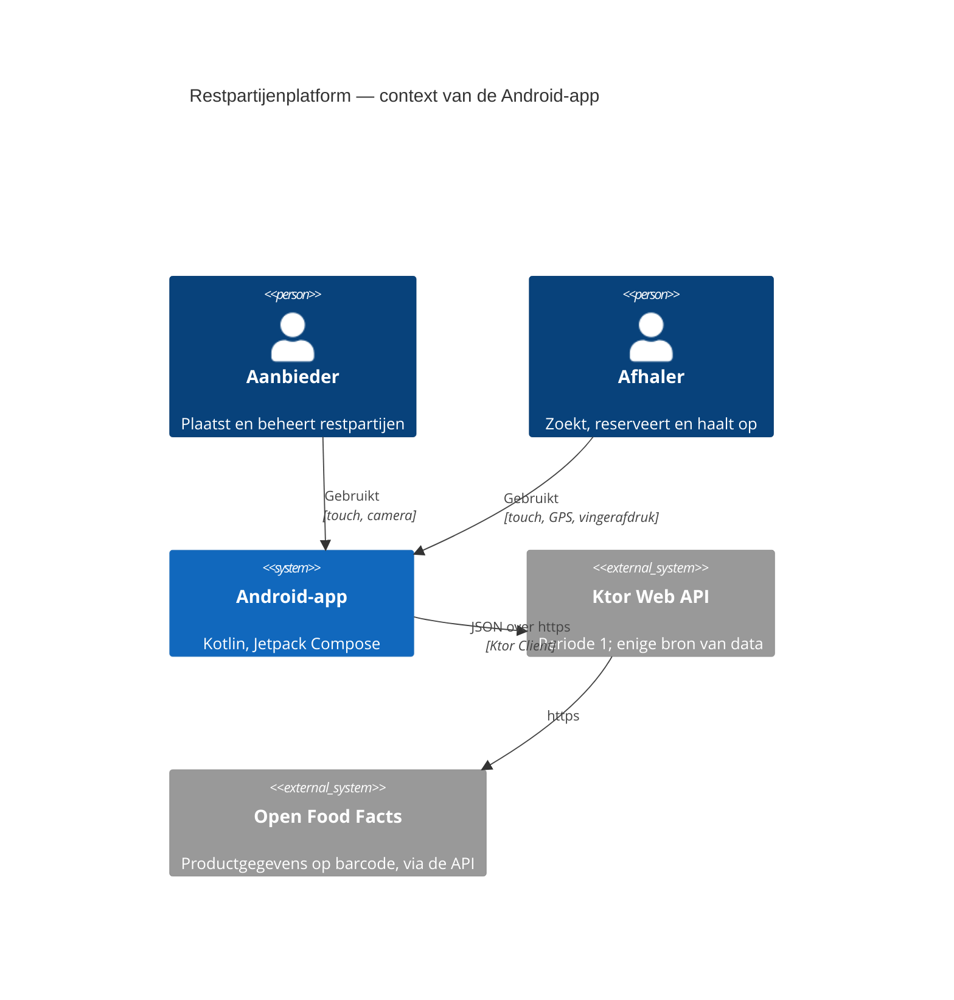
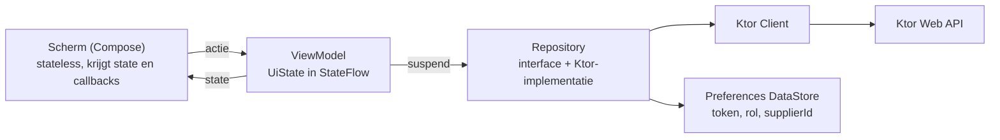
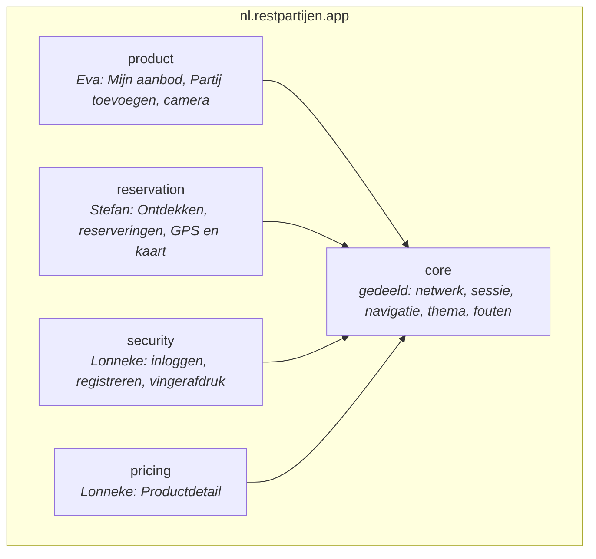

# Restpartijenplatform — Functioneel Technisch Ontwerp Android-app

> **Leeswijzer.** Dit is het ontwerp van deel 2 van de proftaak: de Android-app. Het is een los document naast het *Functioneel Technisch Ontwerp Web API* versie 3.0 (hierna: [[FTD-restpartijen-webapi-v3_0|FTD v3]]). Alles wat de API al vastlegt, staat hier niet opnieuw; FTD v3 wordt niet meer gewijzigd, en wat er aan de API verandert, staat in §12 (A-18). Een verwijzing als "[[FTD-restpartijen-webapi-v3_0#18.4 Request-flow tussen de app en de API|FTD v3 §18.4]]" wijst naar dat document. Het ontwerp groeit per feature mee: een feature is pas af als haar deel in dit document af is (A-02).

## Documentbeheer

| Veld | Waarde |
|------|--------|
| Document ID | FTD-restpartijen-android-app-v1.3 |
| Scenario | project |
| Auteurs | Eva Bouwman, Lonneke van Oers, Stefan Pellikaan |
| Datum | 2026-11-10 |
| Status | Concept. De besluiten van de profgroep van 7 november 2026 en het antwoord van de vakdocent van 8 november zijn verwerkt |
| Classificatie | Intern (schoolproject) |
| Module | AI-powered software development, periode 2, LU1 |
| Akkoord | Besluiten A-01 t/m A-18: profgroep, 7 november 2026. Het document zelf: nog door Stefan en Lonneke te lezen |
| Hoort bij | [[FTD-restpartijen-webapi-v3_0\|FTD v3]]; [[besluiten-ftd-app]] |

## Revisiehistorie

| Versie | Datum | Auteur | Wijziging |
|--------|-------|--------|-----------|
| 1.0 | 2026-11-07 | Eva Bouwman, namens de profgroep | Eerste versie. Op 5 november voorbereid door Eva samen met Claude; de besluiten zijn op 7 november 2026 met Lonneke en Stefan besproken en daarna verwerkt |
| 1.1 | 2026-11-10 | Eva Bouwman, samen met Claude | Antwoord van de vakdocent van 8 november verwerkt: akkoord op CameraX, ML Kit en AndroidX Biometric (A-10, A-11) en op https (W-A1); bouwtool Kotlin Toolchain in IntelliJ IDEA (A-14); R-A1 vervallen, R-A2 vervangen; O-1 en O-2 afgehandeld |
| 1.2 | 2026-11-10 | Eva Bouwman, samen met Claude | §6 gelijkgetrokken met K-A2: US-05 staat op een eigen rij, bij het scherm Productdetail van Lonneke, met de `ReservationRepository` uit `core`; O-11 toegevoegd. Nieuw onderdeel GB-7 in §9: de coverage-meting, van Eva, af vóór haar eigen schermen; §2, §3, NFR-A3 en §18 daarop aangepast |
| 1.3 | 2026-11-10 | Eva Bouwman, samen met Claude | O-11 beslist: de UI-test voor reserveren met `409` hoort bij Lonneke, want een UI-test test een scherm en Productdetail is haar scherm. §6 en §13 aangepast. Voor Stefan staat in §13 een voorstel voor een andere foutsituatie op zijn eigen scherm; hij bevestigt dat (O-11) |

## Besluiten in v1.0

De nummering begint bij A-01, zodat zij niet botst met B-01 tot en met B-64 in FTD v3. De onderbouwing per besluit staat in [[besluiten-ftd-app]].

| # | Onderwerp | Besluit | Wie, wanneer | Status |
|---|-----------|---------|--------------|--------|
| A-01 | Planning | Fase 1 gezamenlijke basis 8–29 nov (18–22 nov persoonlijke ontwikkeling); fase 2 eigen features 30 nov–27 dec; alles af op 10 jan 2027; fase 3 finetunen en film 11–17 jan | Profgroep, 7 nov | Vast |
| A-02 | Definition of Done | Een feature is pas af als haar deel in dit document af is | Profgroep, 7 nov | Vast |
| A-03 | Platform | Alleen Android met Jetpack Compose; KMP wordt een nieuw project in periode 3 | Eva, 5 nov | Vast |
| A-04 | Vorm van het ontwerp | Los document met verwijzingen naar FTD v3; zelfde werkwijze met revisiehistorie en besluitentabel | Profgroep, 7 nov | Vast |
| A-05 | Verdeling | Eva: Mijn aanbod, Partij toevoegen. Stefan: Ontdekken, Mijn reserveringen, Reserveringsdetail. Lonneke: Inloggen en registreren, Productdetail | Profgroep, 7 nov | Vast |
| A-06 | Sensoren | Camera (Eva), GPS (Stefan), vingerafdruk (Lonneke). De accelerometer uit [[FTD-restpartijen-webapi-v3_0#18.1 Sensoren\|FTD v3 §18.1]] vervalt als reserve | Profgroep, 7 nov | Vast |
| A-07 | HTTPS | De API krijgt https; taak in de gezamenlijke basis (GB-3). Uitwerking in §12 | Eva, 5 nov | Vast |
| A-08 | Technieken | De technieken uit de lessen zijn de standaard (§8.6) | Eva, 5 nov | Vast |
| A-09 | Architectuur | Drie lagen: scherm, ViewModel, repository; unidirectional data flow; geen MVI | Profgroep, 7 nov | Vast |
| A-10 | Camera en barcode | CameraX met ML Kit Barcode Scanning, gebundelde variant; niet de Google Code Scanner | Profgroep, 7 nov; akkoord vakdocent, 8 nov | Vast |
| A-11 | Vingerafdruk | AndroidX Biometric (`BiometricPrompt`); eerste keer met wachtwoord, daarna met vingerafdruk | Profgroep, 7 nov; akkoord vakdocent, 8 nov | Vast |
| A-12 | GPS en kaart | MapLibre Compose met `FusedLocationProviderClient` | Vakdocent, september ([[FTD-restpartijen-webapi-v3_0#20. Terugkoppeling van de vakdocent\|FTD v3 §20]]) | Vast |
| A-13 | Token bewaren | Optie B: het token in Preferences DataStore, versleuteld met een sleutel uit de Android Keystore. Terugval op optie A (onversleuteld) als B op 20 dec niet werkt (§16.4) | Profgroep, 7 nov | Vast |
| A-14 | Module en packages | Zelfde repository, map `android/`, één module; packages per feature (§8.3). Bouwtool en IDE: Kotlin Toolchain in IntelliJ IDEA, op advies van de vakdocent. Terugval: omzetten naar Gradle met ktc-to-gradle | Profgroep, 7 nov; bouwtool vakdocent, 8 nov | Vast |
| A-15 | Design patterns | Ieder kiest 2 patterns (1 in eigen code, 1 herkend in een library), zonder dubbele; keuze op 14 nov. MVVM, Repository en DI tellen niet mee | Profgroep, 7 nov | Vast; keuze volgt |
| A-16 | Wireframes | Gegenereerd uit de user stories en [[FTD-restpartijen-webapi-v3_0#18.4 Request-flow tussen de app en de API\|FTD v3 §18.4]], daarna door ieder gecontroleerd; klaar vóór 30 nov | Profgroep, 7 nov | Vast; volgt |
| A-17 | Testen | Test-driven; unit tests voor ViewModels en repository's, UI-tests op de stateless schermen; sensoren vervangen door nepinvoer; seeddata van de API als testdata (§13) | Eva, 5 nov | Vast |
| A-18 | FTD v3 bevroren | FTD v3 wordt niet meer gewijzigd en blijft de bron voor de API. Elke wijziging aan de API staat in §12 van dit document, met het nummer van de paragraaf in FTD v3 die erdoor achterhaald is | Eva, 7 nov | Vast |

## Inhoudsopgave

1. Scope en doelstellingen
2. Betrokkenen en verdeling
3. Planning en werkwijze
4. User stories
5. Acceptatiecriteria
6. Traceability matrix
7. Definition of Done
8. Architectuur
9. Gezamenlijke basis
10. Sensoren
11. API en integratie
12. Wijzigingen aan de Web API
13. Teststrategie
14. Niet-functionele eisen (NFR)
15. Privacy by design
16. Security by design
17. Risico's
18. Begrippenlijst
19. Weggelaten secties en open punten
20. Bronnen

## 1. Scope en doelstellingen

### 1.1 Probleemstelling

De Web API uit periode 1 werkt, maar is alleen met een HTTP-client te bedienen. Een aanbieder in de winkel en een afhaler onderweg hebben een telefoon, geen IntelliJ. Zonder app bereikt het platform zijn gebruikers niet, en blijven de sensoren die de casus sterk maken (barcode scannen, aanbod in de buurt) onbenut.

### 1.2 Doel

Een native Android-app in Kotlin met Jetpack Compose waarmee een aanbieder restpartijen plaatst en beheert, en een afhaler aanbod in de buurt vindt, reserveert en het ophalen bevestigt. De app gebruikt de Ktor API uit periode 1 als enige bron van data ([[FTD-restpartijen-webapi-v3_0#18.3 Wat de API nu al biedt voor periode 2|FTD v3 §18.3]]).

### 1.3 In scope

- Drie tabs met detailschermen, samen zeven schermen ([[FTD-restpartijen-webapi-v3_0#18.2 Navigatiestructuur|FTD v3 §18.2]]), plus een inlogscherm.
- De user stories US-01 t/m US-07, US-10 en US-11 uit FTD v3, nu als schermen in de app, en drie nieuwe stories voor inloggen (§4.2).
- Drie sensoren: camera, GPS en vingerafdruk (A-06).
- Nederlandse en Engelse gebruikersinterface; code en commentaar in het Engels.
- Https op de Ktor API (A-07).
- Unit tests en UI-tests (§13).

### 1.4 Buiten scope

- De beheerfuncties US-08 en US-09. Zij blijven bereikbaar via de HTTP-client van IntelliJ ([[FTD-restpartijen-webapi-v3_0#18.4 Request-flow tussen de app en de API|FTD v3 §18.4]]).
- Een grafiek met het prijsverloop. Lonneke koos voor inloggen en registreren ([[FTD-restpartijen-webapi-v3_0#21. Open punten|FTD v3 §21]]).
- Kotlin Multiplatform, Room, offline werken, navigatie per rol, en alles wat [[FTD-restpartijen-webapi-v3_0#1.6 Buiten scope|FTD v3 §1.6]] al uitsluit.

### 1.5 Succescriteria

- Elke use case uit [[FTD-restpartijen-webapi-v3_0#18.4 Request-flow tussen de app en de API|FTD v3 §18.4]] is in de app te doorlopen en staat in de demofilm.
- De drie sensoren werken in de gebruikersflow op de emulator en op een echte telefoon.
- Per student minimaal drie unit tests; voor de app minimaal drie UI-tests (toetsdocument, deel 2).
- Per student twee design patterns, met klassen- en sequencediagram (A-15).
- Alles werkt op 10 januari 2027; inleveren uiterlijk 17 januari 2027 (A-01).

## 2. Betrokkenen en verdeling

| Wie | Rol | Schermen | Endpoints ([[FTD-restpartijen-webapi-v3_0#10.1 Endpoints\|FTD v3 §10.1]]) | Sensor | Gezamenlijke basis |
|-----|-----|----------|--------------------------|--------|--------------------|
| Eva Bouwman | Student, F1 | Mijn aanbod, Partij toevoegen | `GET /products/lookup/{barcode}`, `POST /products`, `PUT` en `DELETE /products/{id}`, `GET /suppliers/{id}/products`, `GET` en `PUT /suppliers/{id}/opening-hours` | Camera | GB-1, GB-7 |
| Stefan Pellikaan | Student, F2 | Ontdekken (lijst en kaart), Mijn reserveringen, Reserveringsdetail | `GET /products`, `POST` en `GET /reservations`, `DELETE /reservations/{id}`, `POST /reservations/{id}/collect` | GPS | GB-2 |
| Lonneke van Oers | Student, GI-3 | Inloggen en registreren, Productdetail | `POST /auth/login`, `POST /auth/register`, `GET /products/{id}` | Vingerafdruk | GB-3 |
| Paul de Mast | Vakdocent, assessor | Beoordeelt sensoren, libraries buiten de lessen en de bouwtool (§19) | | | |

Verantwoordelijkheden volgen de verdeling: ieder is verantwoordelijk voor de eigen schermen, inclusief tests en het deel in dit document. Besluiten over de gezamenlijke basis en de koppelvlakken neemt de profgroep samen. Een aparte RACI-matrix voegt daar niets aan toe.

De gebruikersrollen zijn die van de API: afhaler, aanbieder en beheerder ([[FTD-restpartijen-webapi-v3_0#1.3 Doelgroep|FTD v3 §1.3]]). De app heeft geen beheerschermen. Zonder inloggen kan een gebruiker zoeken en een partij bekijken; bij de eerste actie die een rol vraagt, verschijnt het inlogscherm ([[FTD-restpartijen-webapi-v3_0#18.4 Request-flow tussen de app en de API|FTD v3 §18.4]]).

## 3. Planning en werkwijze

| Fase | Periode | Inhoud |
|------|---------|--------|
| 0 | t/m 7 nov | Besluiten en dit document (v1.0) |
| 1 | 8 t/m 29 nov | Gezamenlijke basis GB-1 t/m GB-7 (§9). 18 t/m 22 nov: persoonlijke ontwikkeling, geen werk aan de basis |
| 2 | 30 nov t/m 27 dec | Ieder de eigen schermen en sensor |
| Buffer | 28 dec t/m 10 jan | Uitloop en ziekte; alles af op 10 jan |
| 3 | 11 t/m 17 jan | Finetunen, demofilm, inleveren |

In periode 1 werd het einde een race tegen de klok. Daarom is de buffer geen werktijd en is een feature pas af als haar deel in dit document af is (A-02). De profgroep overlegt elke zaterdag online en werkt dinsdags samen op school.

## 4. User stories

Format: "Als *rol*, wil ik *actie*, zodat *waarde*". De stories uit periode 1 zijn niet herschreven; de app geeft ze een scherm.

### 4.1 Stories uit FTD v3

US-01 t/m US-07, US-10 en US-11 krijgen een scherm in de app. Welke story op welk scherm landt en van wie het is, staat in de traceability matrix (§6). US-08 en US-09 blijven buiten de app (§1.4).

### 4.2 Nieuwe stories (Lonneke)

**US-12 — Inloggen**
Als **gebruiker** wil ik inloggen met mijn e-mailadres en wachtwoord, zodat ik kan reserveren of mijn aanbod kan beheren.
*Prioriteit: Must.* INVEST: onafhankelijk van de andere schermen; waarde voor elke actie die een rol vraagt; klein (één scherm, één endpoint); testbaar met een nep-repository.

**US-13 — Account aanmaken**
Als **nieuwe gebruiker** wil ik een account aanmaken met e-mailadres, wachtwoord en weergavenaam, zodat ik partijen kan reserveren.
*Prioriteit: Must.* INVEST: zelfde scherm als US-12 maar een eigen flow; een nieuw account is altijd een afhaler ([[FTD-restpartijen-webapi-v3_0#GI-3 Authenticatie en rollen — uitvoering: Lonneke|FTD v3 GI-3, besluit 3.7]]).

**US-14 — Inloggen met vingerafdruk**
Als **gebruiker die al eens is ingelogd** wil ik de app met mijn vingerafdruk ontgrendelen, zodat ik niet elke keer mijn wachtwoord hoef in te typen.
*Prioriteit: Should.* INVEST: bouwt op US-12 en op het bewaarde token (A-13); valt zonder gevolgen terug op wachtwoord als het toestel geen biometrie heeft. De API verandert niet.

## 5. Acceptatiecriteria
<!-- ac-format: bullets -->

De criteria beschrijven wat de app doet. Wat de API teruggeeft, staat in [[FTD-restpartijen-webapi-v3_0#5. Acceptatiecriteria|FTD v3 §5]] en [[FTD-restpartijen-webapi-v3_0#18.4 Request-flow tussen de app en de API|§18.4]] en wordt hier niet herhaald.

### 5.1 Partij toevoegen (US-01, US-02 — Eva)

- Na het scannen van een geldige barcode zijn de velden productnaam en allergenen voorgevuld met het antwoord van `GET /products/lookup/{barcode}`.
- Bij `404`, een leeg antwoord of `manualEntryRequired` blijft het formulier leeg en kan de aanbieder alles zelf invullen; plaatsen blijft mogelijk.
- Zonder cameratoestemming toont het scherm een uitleg en een knop "Handmatig invoeren".
- Een lege productnaam geeft een melding bij het veld voordat er een request gaat.
- Bij `422` toont de app de melding uit het antwoord bij het veld dat `field` noemt.
- Bij `201` gaat de app terug naar Mijn aanbod en staat de nieuwe partij in de lijst.

### 5.2 Mijn aanbod (US-03, US-10 — Eva)

- Het scherm toont de partijen met status `LISTED` en `RESERVED` van de ingelogde aanbieder, met naam, actuele prijs en afhaalvenster.
- Een `LISTED` partij is te wijzigen en te verwijderen; bij een `RESERVED` partij zijn beide acties uitgeschakeld, met uitleg.
- De openingstijden zijn per dag te bekijken en te wijzigen; bij `422` toont de app de melding bij de betreffende dag.

### 5.3 Ontdekken (US-04 — Stefan)

- De lijst toont per partij naam, productsoort, actuele prijs, resterende houdbaarheid en de afstand tot de gebruiker.
- Filteren op productsoort, maximumprijs en minimale houdbaarheid stuurt de filters mee in `GET /products`; de lijst toont alleen passende partijen.
- Zonder locatietoestemming toont de lijst geen afstand en toont de kaart geen eigen positie; de rest werkt.
- De kaart toont elke aanbieder uit het resultaat als marker op de eigen coördinaten; tikken op een marker opent Productdetail.

### 5.4 Productdetail (US-07, US-05 — Lonneke, Stefan)

- Het scherm toont oorspronkelijke prijs, kortingspercentage en actuele prijs, zoals de API ze geeft.
- Een partij met status `EXPIRED` toont "niet meer beschikbaar" en geen knop "Reserveren".
- "Reserveren" zonder geldig token opent het inlogscherm; na inloggen keert de app terug naar dit scherm en voert de reservering alsnog uit.
- Bij `201` toont de app de reservering met de vastgelegde prijs en het afhaalvenster; bij `409` een melding en daarna een ververste lijst.

### 5.5 Mijn reserveringen en Reserveringsdetail (US-06, US-11 — Stefan)

- De lijst toont de eigen reserveringen, de nieuwste eerst, met status en afhaalvenster.
- Intrekken vraagt om bevestiging; bij `204` verdwijnt de reservering uit de lijst; bij `409` legt de melding uit dat zij al is afgehandeld.
- Ophalen bevestigen toont bij `200` een bevestigingsscherm dat de aanbieder kan zien; bij `422` meldt de app dat het moment buiten het afhaalvenster valt.

### 5.6 Inloggen en registreren (US-12, US-13 — Lonneke)

- Inloggen met een juist e-mailadres en wachtwoord bewaart het token, de rol en bij een aanbieder het `supplierId`, en gaat terug naar de actie waar de gebruiker mee bezig was.
- Bij `401` toont de app één melding ("e-mailadres of wachtwoord klopt niet") zonder te zeggen welk veld fout is.
- Registreren met een wachtwoord korter dan 8 tekens toont de melding bij het veld (`400` met `field`, [[FTD-restpartijen-webapi-v3_0#Besluiten in v3.0|FTD v3 B-56]]); bij `409` meldt de app dat het e-mailadres al bestaat.
- Na `201` bij registreren logt de app de gebruiker direct in.
- Uitloggen wist het token; de app toont daarna weer alleen de openbare schermen.

### 5.7 Inloggen met vingerafdruk (US-14 — Lonneke)

- Bij het openen van de app met een bewaard token vraagt de app om een vingerafdruk; na herkenning is de gebruiker ingelogd zonder wachtwoord.
- Mislukt de herkenning, of heeft het toestel geen biometrie, dan toont de app het gewone inlogscherm.
- Is het bewaarde token verlopen (`401` bij de eerstvolgende aanroep), dan wist de app het token en vraagt zij om het wachtwoord.

### 5.8 Geldt voor alle schermen

- Elke tekst in de interface komt uit `strings.xml` en is in het Nederlands en het Engels beschikbaar; de taal volgt het toestel.
- Draaien van het scherm verliest geen ingevulde invoer en geen geladen lijst.
- Tijdens het laden toont het scherm een voortgangsindicator; een fout uit de API toont de `message` uit het foutmodel ([[FTD-restpartijen-webapi-v3_0#10.2 Validatie en foutafhandeling|FTD v3 §10.2]]).

## 6. Traceability matrix

| Story | Scherm | ViewModel en repository | Endpoint | Test | Eigenaar |
|-------|--------|-------------------------|----------|------|----------|
| US-01, US-02 | Partij toevoegen | `AddProductViewModel`, `ProductRepository`, `BarcodeScanner` | `GET /products/lookup/{barcode}`, `POST /products` | UT-E1, UI-E1 | Eva |
| US-03, US-10 | Mijn aanbod | `MyOfferViewModel`, `ProductRepository`, `OpeningHoursRepository` | `GET /suppliers/{id}/products`, `PUT`/`DELETE /products/{id}`, `GET`/`PUT /suppliers/{id}/opening-hours` | UT-E2, UI-E2 | Eva |
| US-04 | Ontdekken | `DiscoverViewModel`, `SearchRepository`, `LocationProvider` | `GET /products` | UT-S1, UI-S1 | Stefan |
| US-05 | Productdetail (knop "Reserveren") | `ProductDetailViewModel` roept `ReservationRepository` uit `core` aan (K-A2) | `POST /reservations` | UT-S2 (repository, Stefan); UI-L1 (knop en `409`, Lonneke) | Lonneke: knop en ViewModel. Stefan: de repository |
| US-06, US-11 | Mijn reserveringen, Reserveringsdetail | `ReservationViewModel`, `ReservationRepository` | `GET /reservations`, `DELETE /reservations/{id}`, `POST /reservations/{id}/collect` | UT-S2, UI-S2 | Stefan |
| US-07 | Productdetail | `ProductDetailViewModel`, `ProductRepository` | `GET /products/{id}` | UT-L1, UI-L1 | Lonneke |
| US-12, US-13 | Inloggen en registreren | `AuthViewModel`, `AuthRepository`, `SessionStore` | `POST /auth/login`, `POST /auth/register` | UT-L2, UI-L2 | Lonneke |
| US-14 | Inloggen (vingerafdruk) | `AuthViewModel`, `BiometricUnlock`, `SessionStore` | geen | UT-L3 | Lonneke |

Productdetail is één scherm met één ViewModel, en het scherm is van Lonneke (A-05). De knop "Reserveren" hoort daarom bij haar; wat de knop doet, zit in de `ReservationRepository` van Stefan. Zo gebruikt de ene feature de andere niet rechtstreeks (§8.3, K-A2).

De klassennamen zijn een voorstel. Ieder werkt de eigen rij uit in het klassendiagram van de eigen feature (§19, open punt O-5).

## 7. Definition of Done

Een story is af als:

- [ ] De code is gemerged via een pull request met minimaal één review door een groepsgenoot.
- [ ] De unit tests voor de ViewModel en de repository zijn groen, inclusief minimaal één foutsituatie.
- [ ] De UI-test voor de hoofdactie van de story is groen (§13).
- [ ] Alle acceptatiecriteria uit §5 zijn aantoonbaar gehaald, op de emulator.
- [ ] Alle teksten staan in `strings.xml` in NL en EN.
- [ ] ktlint geeft geen meldingen en de build heeft geen warnings.
- [ ] Het deel van deze story in dit document is bijgewerkt: acceptatiecriteria, traceability, klassendiagram (A-02).
- [ ] De eigenaar kan de code, de keuzes en de testaanpak zelfstandig toelichten.
- [ ] Het gebruik van AI-tooling bij deze story staat in het AI-logboek.

## 8. Architectuur

### 8.1 Context (C4 niveau 1)

De app praat alleen met de eigen API. Open Food Facts bereikt zij nooit rechtstreeks: de lookup loopt via `GET /products/lookup/{barcode}` ([[FTD-restpartijen-webapi-v3_0#10.3 Integratie met Open Food Facts|FTD v3 §10.3]]). De kaarttegels van MapLibre komen van een tegelserver; dat is de enige andere externe verbinding (§10).

### 8.2 Drie lagen en unidirectional data flow (A-09, tevens containerniveau C4)

Een scherm toont de state en stuurt acties naar de ViewModel. De ViewModel verwerkt de actie, vraagt de repository om data en zet de nieuwe state in een `StateFlow`. Het scherm tekent zichzelf opnieuw. Data stroomt dus één kant op; een scherm wijzigt nooit zelf data. Dit is de opbouw die Google aanraadt en die de lessen 10 t/m 12 behandelen (Android Developers, z.j.-a).

Dit is de scheiding tussen UI en logica die de toets vraagt: het scherm bevat geen bedrijfsregels, de ViewModel bevat geen Compose, en de repository is een interface die in tests door een nep-implementatie wordt vervangen. MVI is overwogen en afgewezen: het voegt voor deze omvang alleen ceremonie toe en zit niet in de lessen.

### 8.3 Packagestructuur (A-14)

Elke featurepackage heeft `ui` (schermen en ViewModels) en `data` (repository, DTO's, sensoradapter). Features gebruiken `core`, nooit elkaar; wat de ene feature van de andere nodig heeft, loopt via navigatie-argumenten of via een interface in `core` (§8.5). De indeling spiegelt de API ([[FTD-restpartijen-webapi-v3_0#8.3 Packagestructuur|FTD v3 §8.3]]), zodat bij het assessment direct te zien is welke code van wie is. De packagenaam is een voorstel; we leggen hem vast in GB-4 (A-14).

### 8.4 Navigatie

Navigation 3 met een bottom navigation van drie tabs: Ontdekken, Reserveringen, Mijn aanbod ([[FTD-restpartijen-webapi-v3_0#18.2 Navigatiestructuur|FTD v3 §18.2]]). Elk scherm is een route met een eigen `NavKey`; het inlogscherm is een route die bovenop elke tab kan verschijnen en na succes terugkeert naar de route die hem opende. Navigation 3 is nieuw (stabiel sinds november 2025); AI-tools en oudere voorbeelden leveren vaak code voor de oudere Navigation Compose. Dat is een vast punt in de AI-verantwoording: elke suggestie wordt tegen de actuele documentatie gecontroleerd.

### 8.5 Koppelvlakken tussen de features

| # | Van | Naar | Afspraak |
|---|-----|------|----------|
| K-A1 | Ontdekken (Stefan) | Productdetail (Lonneke) | De route krijgt het `productId` als argument; niets anders |
| K-A2 | Productdetail (Lonneke) | Reserveren (Stefan) | Lonneke tekent de knop; de knop roept `ReservationRepository.reserve(productId)` uit `core` aan, die Stefan implementeert |
| K-A3 | Elke actie die een rol vraagt | Inloggen (Lonneke) | Bij ontbrekend token of `401` opent `core` het inlogscherm en onthoudt de route om naar terug te keren |
| K-A4 | Inloggen (Lonneke) | Mijn aanbod (Eva) | Na inloggen staan rol en `supplierId` in `SessionStore` in `core`; Mijn aanbod leest het `supplierId` daar |

### 8.6 Technische keuzes (A-08)

| Keuze | Waarom | Alternatief, afgewezen omdat |
|-------|--------|------------------------------|
| Jetpack Compose, Material 3 | Verplicht: MAD volgens de lessen | Views: verouderd, niet in de les |
| Navigation 3 | Lesstof (les 10) | Navigation Compose: oudere API |
| Ktor Client, kotlinx.serialization | Lesstof (les 11); zelfde libraries als de API | Retrofit: door de docent verouderd genoemd |
| Koin | Dependency injection uit de lessen; eenvoudig te vervangen door nep-implementaties in tests | Hilt: meer configuratie, niet in de les |
| Preferences DataStore, geen Room | De API is de database; de app bewaart alleen de sessie (A-13) | Room: zou data dupliceren die de API al beheert |
| Coil | Lesstof; afbeeldingen van producten als die er komen | – |
| MapLibre Compose, `FusedLocationProviderClient` | Advies van de docent (A-12) | Google Maps: sleutel en account nodig |
| CameraX, ML Kit Barcode Scanning (gebundeld) | Eigen camerascherm laat de sensor zien; werkt zonder download (A-10) | Google Code Scanner: camera in Play services, niet in onze app |
| AndroidX Biometric | Jetpack; Android raadt wachtwoord eerst en biometrie daarna aan (A-11) | Eigen implementatie: onnodig en onveiliger |
| Kotlin Toolchain in IntelliJ IDEA | Advies van de vakdocent voor nieuwe projecten; zelfde bouwtool als de server; terugval naar Gradle kan met ktc-to-gradle (A-14) | Gradle in Android Studio: later overstappen naar de Toolchain is veel lastiger dan andersom |

Extra libraries buiten deze tabel mogen, als ze op klibs.io staan (akkoord vakdocent, 8 nov).

### 8.7 Kwaliteitsscenario's

- **Draaien.** De gebruiker draait het toestel tijdens het invullen van Partij toevoegen; alle ingevulde velden blijven staan (UI-test).
- **Geen netwerk.** De API is onbereikbaar; Ontdekken toont binnen 5 seconden een melding met "Opnieuw" en de app crasht niet.
- **Verlopen token.** Een aanroep krijgt `401`; de app wist het token, opent het inlogscherm en keert na inloggen terug naar de actie (K-A3).
- **Sensor ontbreekt.** Geen camera, geen GPS of geen vingerafdruklezer: elk scherm heeft een route zonder de sensor (§5.1, §5.3, §5.7).

## 9. Gezamenlijke basis

Klaar in fase 1, voordat iemand aan de eigen schermen begint. Ieder bouwt het gedeelde deel dat bij de eigen rol past, net als in periode 1 ([[FTD-restpartijen-webapi-v3_0#13. Gedeelde infrastructuur (GI-1 t/m GI-6)|FTD v3 §13]]).

| # | Onderdeel | Inhoud | Eigenaar |
|---|-----------|--------|----------|
| GB-1 | Data- en netwerklaag | Ktor Client met kotlinx.serialization, basis-URL per omgeving, Koin-opzet, basisinterface voor repository's, DTO's van het foutmodel | Eva |
| GB-2 | Navigatie en foutafhandeling | Navigation 3, bottom navigation, het foutmodel van de API op één plek omzetten naar een melding ([[FTD-restpartijen-webapi-v3_0#10.2 Validatie en foutafhandeling\|FTD v3 §10.2]]), K-A3 | Stefan |
| GB-3 | Sessie en beveiliging | `SessionStore` op DataStore (A-13), token meesturen in de `Authorization`-header, https op de Ktor API (A-07) | Lonneke |
| GB-4 | Projectopzet | Map `android/`, Kotlin Toolchain (A-14), ktlint, lege packages uit §8.3 | Samen |
| GB-5 | Thema en teksten | Material 3-thema, `strings.xml` in NL en EN, gedeelde onderdelen voor laden en fouten | Samen |
| GB-6 | Test-setup | Eén voorbeeld-unit test (ViewModel met nep-repository) en één voorbeeld-UI-test | Samen |
| GB-7 | Coverage-meting | Uitzoeken hoe de regeldekking van NFR-A3 in de Android-module gemeten wordt; uitgangspunt is de JaCoCo-plugin die de server al gebruikt. Daarna Stefan en Lonneke uitleggen hoe zij de meting draaien en het rapport lezen. Af voordat Eva aan haar eigen schermen begint | Eva |

Navigatie komt pas in les 10 en de Ktor Client in les 11; tot die tijd leert ieder vooruit met unit 3 en 4 en de voorbeeldcode van de docent.

## 10. Sensoren

| Sensor | Eigenaar | Library | Toestemming | In de flow | In tests |
|--------|----------|---------|-------------|------------|----------|
| Camera | Eva | CameraX met ML Kit Barcode Scanning, gebundeld (`com.google.mlkit:barcode-scanning`) | `CAMERA`, gevraagd op het moment van scannen | Partij toevoegen: scannen vult naam en allergenen voor (US-02) | `BarcodeScanner` is een interface; de test geeft een vaste barcode |
| GPS | Stefan | `FusedLocationProviderClient`; kaart met MapLibre Compose | `ACCESS_COARSE_LOCATION` en `ACCESS_FINE_LOCATION`, gevraagd bij het openen van Ontdekken | Afstand per partij en eigen positie op de kaart (US-04) | `LocationProvider` is een interface; de test geeft een vaste locatie |
| Vingerafdruk | Lonneke | AndroidX Biometric (`BiometricPrompt`) | Geen aparte toestemming; het toestel moet biometrie hebben | App ontgrendelen bij een bewaard token (US-14) | `BiometricUnlock` is een interface; de test geeft "herkend" of "mislukt" |

**Camera.** ML Kit herkent EAN-13, EAN-8, UPC-A en UPC-E, de barcodes op levensmiddelen. De gebundelde variant zit in de APK, dus scannen werkt zonder download. Na de eerste herkende barcode stopt de analyse en gaat de code naar de ViewModel. De vormcontrole (7 t/m 14 cijfers) doet de API ([[FTD-restpartijen-webapi-v3_0#Besluiten in v3.0|FTD v3 B-58]]).

**GPS.** De app berekent de afstand zelf met de coördinaten van de aanbieder uit het zoekresultaat; de positie van de gebruiker gaat nooit naar de API ([[FTD-restpartijen-webapi-v3_0#18.1 Sensoren|FTD v3 §18.1]]). Welke tegelserver de kaart gebruikt, bepaalt Stefan in fase 2 (O-6).

**Vingerafdruk.** De eerste keer logt de gebruiker in met het wachtwoord; daarna bewaart de app het token versleuteld (A-13). Bij het openen vraagt `BiometricPrompt` om een vingerafdruk; na herkenning ontgrendelt de Keystore-sleutel het token. De emulator doet dit na met het consolecommando `finger touch`. Na 24 uur is het token verlopen en is het wachtwoord weer nodig ([[FTD-restpartijen-webapi-v3_0#16.1 Authenticatie en sessiebeheer|FTD v3 §16.1]]).

## 11. API en integratie

### 11.1 Gebruik van de API

Alle endpoints staan in [[FTD-restpartijen-webapi-v3_0#10.1 Endpoints|FTD v3 §10.1]]; welke de app per use case aanroept, en in welke volgorde, in [[FTD-restpartijen-webapi-v3_0#18.4 Request-flow tussen de app en de API|FTD v3 §18.4]]. Basis-URL: `https://<host>:<poort>/api/v1`. De host staat in één configuratiebestand (GB-1), zodat de emulator (`10.0.2.2`) en een telefoon in hetzelfde netwerk zonder codewijziging werken. Bedragen komen in euro's binnen en worden niet omgerekend ([[FTD-restpartijen-webapi-v3_0#Besluiten van de startsessie en daarna (v2.2)|FTD v3 B-25]]).

### 11.2 Foutafhandeling

Elke fout heeft één vorm: `code`, `message`, optioneel `field` ([[FTD-restpartijen-webapi-v3_0#10.2 Validatie en foutafhandeling|FTD v3 §10.2]]). GB-2 zet die op één plek om naar app-gedrag:

| Statuscode | Gedrag in de app |
|------------|------------------|
| `400` met `field` | Melding bij dat veld |
| `400` zonder `field` | Fout in de app zelf: algemene melding en een regel in de log |
| `401` | Token wissen, inlogscherm, daarna terug (K-A3) |
| `403` | Melding "hiervoor heb je een ander soort account nodig" |
| `404` | Melding en terug naar het vorige scherm |
| `409` | Melding uit het antwoord, daarna de gegevens verversen |
| `422` | Melding bij het veld dat `field` noemt |
| `500` en netwerkfouten | Melding en een knop "Opnieuw" |

### 11.3 Https

Android staat standaard geen onversleuteld http toe. De API krijgt daarom https (A-07). Wat er aan de API verandert, staat in §12; wat de app doet, in §16.3.

## 12. Wijzigingen aan de Web API

FTD v3 wordt niet meer gewijzigd (A-18). Dit hoofdstuk is de enige plek waar wijzigingen aan de API staan. Per wijziging staat welke paragraaf van FTD v3 erdoor achterhaald is, zodat FTD v3 bruikbaar blijft als bron.

| # | Wijziging | Achterhaalt in FTD v3 | Eigenaar | Status |
|---|-----------|-----------------------|----------|--------|
| W-A1 | De API luistert op https met een zelfondertekend certificaat | §16.3 (http als bewuste keuze), §8.1 en §8.2 (noemen al https) | Lonneke (GB-3) | Open; fase 1. Akkoord vakdocent, 8 nov |

Er zijn geen andere wijzigingen gepland. Alles wat de app nodig heeft, biedt de API al ([[FTD-restpartijen-webapi-v3_0#18.3 Wat de API nu al biedt voor periode 2|FTD v3 §18.3]]). Komt er in fase 2 toch iets bij, dan krijgt het hier een regel W-A2 en zo verder.

### 12.1 W-A1: https op de Ktor API

- **Waarom.** Android blokkeert standaard verkeer over http (`cleartextTrafficPermitted` staat uit). De lesbeschrijving noemt dit; zonder https bereikt de app de API niet.
- **Akkoord.** De vakdocent vindt https zelfs beter dan http (8 nov).
- **Wat.** Ktor krijgt naast de http-connector een `sslConnector` met een keystore. De instellingen komen uit de omgeving, net als `JWT_SECRET` ([[FTD-restpartijen-webapi-v3_0#16.4 Secrets|FTD v3 §16.4]]): pad naar de keystore, wachtwoord van de keystore en van de sleutel, en de alias. `.env.example` en de README noemen ze. De http-connector blijft bestaan voor de HTTP-client van IntelliJ en de demo-frontend.
- **Certificaat.** Zelfondertekend, gemaakt met `keytool`, geldig voor `localhost` en `10.0.2.2`. Het certificaat (niet de sleutel) staat als `.crt` in `android/` zodat de app het kan vertrouwen (§16.3). De keystore zelf staat niet in de repository.
- **Wat niet verandert.** Endpoints, foutmodel, JWT en seeddata blijven zoals in FTD v3. De code freeze van 24 oktober 2026 wordt voor deze ene wijziging opgeheven; de wijziging komt via een pull request met review.
- **Test.** Een integratietest die over https inlogt en een beschermde endpoint aanroept; daarnaast de bestaande testen, die via `testApplication` geen connector gebruiken en dus niet veranderen.
- **Terugval.** Werkt het certificaat niet op de emulator of de telefoon (R-A6), dan staat de API tijdelijk ook op http en zet de app in de debug-build cleartext aan voor alleen de host van de API. Dat staat dan hier als W-A2 met motivatie.

## 13. Teststrategie (A-17)

| Soort | Wat | Hoe | Minimum |
|-------|-----|-----|---------|
| Unit test | ViewModels | Nep-repository, `runTest`, controle van de `UiState` na een actie | 3 per student, waarvan 1 foutsituatie |
| Unit test | Repository's | Ktor `MockEngine` met een vast JSON-antwoord, ook het foutmodel | Per repository minimaal 1 |
| UI-test | Stateless schermen | Compose UI testing: het scherm krijgt een vaste state, de test drukt en controleert | 3 voor de app; per student 1 hoofdactie en 1 foutsituatie, plus 1 navigatietest |
| Nepinvoer | Sensoren | De interfaces uit §10 krijgen een nep-implementatie | Geen echte sensor in een test |

Representatieve UI-tests per student (uit [[besluiten-ftd-app]]): Eva: na het scannen is het formulier voorgevuld; lege naam geeft een melding. Stefan: filter op maximumprijs toont alleen passende partijen; intrekken met `409` meldt dat de reservering al is afgehandeld (voorstel, O-11). Lonneke: Productdetail toont de prijsopbouw; reserveren met `409` geeft een melding en ververste gegevens; een te kort wachtwoord geeft een melding bij het veld. Een UI-test hoort bij de eigenaar van het scherm: daarom staat reserveren met `409` bij Lonneke en niet bij Stefan (v1.3). Dat de repository de `409` goed doorgeeft, test Stefan in zijn unit test. Testdata is de seeddata van de API ([[FTD-restpartijen-webapi-v3_0#9.7 Seeddata|FTD v3 §9.7]]), zodat de docent met dezelfde accounts kan testen.

Werkwijze: test-driven, van rood naar groen, zoals in periode 1. Een test die alleen controleert of een tekst op het scherm staat, telt niet als representatief.

## 14. Niet-functionele eisen (NFR)

| ID | Onderwerp | Eigenschap | Meeteenheid | Drempel | Verificatie |
|----|-----------|------------|-------------|---------|-------------|
| NFR-A1 | Interface | tweetaligheid | teksten buiten `strings.xml` | 0 | Android Lint-regel `HardcodedText` als fout |
| NFR-A2 | Broncode | stijl | ktlint-meldingen en compilerwarnings | 0 | ktlint en `allWarningsAsErrors` in de build |
| NFR-A3 | ViewModels en repository's | testdekking | regeldekking | ≥ 80% | Meetwijze volgt uit GB-7 (uitgangspunt: JaCoCo, zoals op de server); export in de testrapportage |
| NFR-A4 | Ontdekken | responsiviteit | tijd van antwoord van de API tot getekende lijst | < 1 s | Handmatig met de seeddata op de emulator, in de testrapportage |
| NFR-A5 | Alle schermen | robuustheid | crashes bij draaien, geen netwerk, geen sensor | 0 | De kwaliteitsscenario's in §8.7 als tests |
| NFR-A6 | App | compatibiliteit | minimale Android-versie | nog te bepalen (O-3) | `minSdk` in de build |

De drempels zijn bescheiden: de app draait op een emulator en één telefoon, tegen een API op dezelfde laptop.

## 15. Privacy by design

De app verwerkt persoonsgegevens, maar alleen verzonnen seeddata en alleen voor de demo. Het ontwerp beschrijft wel wat bij echt gebruik zou gelden.

| Gegeven | Waar | Waarvoor | Blijft op het toestel? |
|---------|------|----------|------------------------|
| E-mailadres, wachtwoord | Inlogscherm, alleen in het geheugen tijdens het request | Inloggen | Nee: naar de API over https; nooit opgeslagen |
| Token, rol, `supplierId` | DataStore, versleuteld (A-13) | Sessie | Ja; gewist bij uitloggen en bij `401` |
| Locatie van de gebruiker | Geheugen van de ViewModel | Afstand en kaart | Ja: gaat nooit naar de API ([[FTD-restpartijen-webapi-v3_0#18.1 Sensoren\|FTD v3 §18.1]]) |
| Camerabeelden | Geheugen, tijdens het scannen | Barcode herkennen | Ja: alleen de barcode gaat naar de API; geen beeld wordt bewaard |
| Vingerafdruk | Beveiligde hardware van het toestel | Ontgrendelen | Ja: de app ziet alleen "herkend" of "mislukt", nooit de afdruk |

- **Dataminimalisatie.** De app bewaart niets buiten de sessie. Geen cache van partijen, geen locatiegeschiedenis, geen beelden.
- **Doelbinding.** Locatie dient alleen voor afstand en kaart; de camera alleen voor de barcode; biometrie alleen voor ontgrendelen.
- **Toestemming op het moment zelf.** Camera- en locatietoestemming worden gevraagd bij de actie die ze nodig heeft, met uitleg, en zijn te weigeren zonder dat de rest stopt (§5.1, §5.3).
- **Rechten van betrokkenen.** Inzage, correctie en verwijdering van een account zijn geen onderdeel van dit project; [[FTD-restpartijen-webapi-v3_0#15. Privacy by design|FTD v3 §15]] legt uit waarom.

## 16. Security by design

### 16.1 Authenticatie en sessie

- JWT van `POST /auth/login`, 24 uur geldig, geen refresh tokens ([[FTD-restpartijen-webapi-v3_0#16.1 Authenticatie en sessiebeheer|FTD v3 §16.1]]). De app stuurt het mee als `Authorization: Bearer <token>` via een plugin van de Ktor Client, op één plek (GB-3).
- Alleen de server hasht wachtwoorden; de app stuurt het wachtwoord één keer over https en bewaart het nooit.
- Biometrie vervangt het wachtwoord niet: zij ontgrendelt een bewaard token dat de server eerder uitgaf (§10).

### 16.2 Autorisatie

De API beslist ([[FTD-restpartijen-webapi-v3_0#16.2 Autorisatiemodel|FTD v3 §16.2]]). De app verbergt alleen wat voor de rol niet zinvol is, zoals de tab Mijn aanbod voor een afhaler, en toont bij `403` een melding. Een verborgen knop is geen beveiliging; daarom controleert de app nooit zelf of iets mag.

### 16.3 Versleuteling

- In transit: https naar de API (A-07). Cleartext blijft uit; de `network_security_config.xml` vertrouwt in de debug-build alleen het zelfondertekende certificaat van onze API (W-A1, §12.1).
- At rest: het token in DataStore, versleuteld met een AES-sleutel uit de Android Keystore die aan de vingerafdruk is gekoppeld (A-13). De sleutel verlaat de Keystore niet.

### 16.4 Terugvaloptie voor het token (A-13)

Werkt optie B op 20 december niet, dan bewaart de app het token onversleuteld in DataStore en ontgrendelt de vingerafdruk alleen het scherm (`BiometricPrompt` zonder `CryptoObject`). Het risico blijft beperkt: de sandbox van Android schermt de opslag van de app af voor andere apps, het token verloopt na 24 uur, en de app wist het bij uitloggen en bij `401`. Wie deze terugval gebruikt, legt hier vast waarom en welk risico overblijft. `EncryptedSharedPreferences` is geen optie: die library is door Google afgeschaft (O-7).

### 16.5 Secrets en afhankelijkheden

- De app bevat geen secrets; het JWT-secret staat alleen op de server. Versies staan vast in de buildconfiguratie (A-14); een automatische kwetsbaarheidsscan is er niet, net als in [[FTD-restpartijen-webapi-v3_0#16.6 Afhankelijkheden|FTD v3 §16.6]].
- De ingeleverde zip bevat geen `.env`, `.git` of `.claude/settings.local.json` (les uit periode 1).

### 16.6 Logging

Alleen in de debug-build: methode, pad en statuscode van elk request. Nooit het token, de `Authorization`-header, wachtwoorden of locaties.

## 17. Risico's

| ID | Risico | Kans | Impact | Maatregel | Eigenaar |
|----|--------|------|--------|-----------|----------|
| R-A1 | De vakdocent keurt CameraX, ML Kit of AndroidX Biometric af | – | – | Vervallen: akkoord vakdocent, 8 nov | Eva |
| R-A2 | De Kotlin Toolchain is Alpha: een Gradle compiler plugin kan ontbreken, en IntelliJ loopt achter op Android Studio bij de Android-tools | Midden | Midden | Probleem melden bij Kotlin Toolchain (issues worden snel opgepakt); voor Android-tools kort naar Android Studio; onoplosbaar, dan omzetten naar Gradle met ktc-to-gradle | Samen |
| R-A3 | Navigatie en Ktor Client komen pas in les 10 en 11, na de start van fase 1 | Hoog | Midden | Vooruit leren met unit 3 en 4 en de voorbeeldcode van de docent (`fsa-lunch-tray-nav3`, `fsaSimpleRick`) | Stefan, Eva |
| R-A4 | Optie B voor het token kost Lonneke te veel tijd | Midden | Laag | Beslisdatum 20 dec; terugval A ligt klaar (§16.4) | Lonneke |
| R-A5 | De buffer is kleiner dan in het oorspronkelijke plan; fase 3 is één week | Midden | Midden | Elke zaterdag toetsen of ieder op schema ligt; bij achterstand een Should-story laten vallen (US-10, US-14) | Samen |
| R-A6 | Https met een zelfondertekend certificaat werkt niet op de emulator of de telefoon | Midden | Hoog | In GB-3 als eerste testen; terugval is `cleartextTrafficPermitted` alleen in de debug-build, vastgelegd als W-A2 in §12 | Lonneke |

## 18. Begrippenlijst

| Term | Betekenis |
|------|-----------|
| Compose | Jetpack Compose, de UI-toolkit waarin schermen als functies zijn geschreven |
| State hoisting | De toestand niet in het scherm bewaren maar erboven, zodat het scherm stateless en testbaar is |
| ViewModel | Klasse die de toestand van een scherm bijhoudt en het draaien van het scherm overleeft |
| Repository | Laag die de data haalt en bewaart; de ViewModel kent alleen de interface |
| DataStore | Jetpack-opslag voor kleine sleutel-waardeparen; hier voor de sessie |
| Keystore | Beveiligde sleutelopslag van Android; sleutels verlaten haar niet |
| GB | Gezamenlijke basis; de zeven onderdelen uit §9 |
| K-A | Koppelvlak in de app; de vier afspraken uit §8.5 |

## 19. Weggelaten secties en open punten

### 19.1 Weggelaten secties

| Sectie | Reden |
|--------|-------|
| Executive summary | De leeswijzer en §1 volstaan voor een document van deze omvang |
| RACI-matrix | De verdeling in §2 is de volledige verantwoordelijkheid; een matrix zou haar herhalen |
| Bedrijfscontext en benefit hypothesis | Schoolproject zonder meetbare bedrijfsdoelstelling; de toetscriteria zijn het doel (§1.5) |
| Definition of Ready | De besluiten en user stories zijn vóór de start vastgelegd; een aparte DoR herhaalt §4 en §5 |
| Datamodel | De API beheert alle data ([[FTD-restpartijen-webapi-v3_0#9. Datamodel en persistentie\|FTD v3 §9]]); de app bewaart alleen de sessie (§15) |
| Deployment en rollback | De app draait op een emulator of één telefoon; installatie staat in het ontwikkeldocument |
| Observability, migratie en runbook | Logging staat in §16.6; verder niet van toepassing voor een nieuwe app zonder bestaande data |
| Compliance evidence, threat model, SBOM | Niet vereist voor scenario project; privacy en security staan in §15 en §16 |
| Approvals en sign-off | Eén regel "Akkoord" in Documentbeheer volstaat voor een profgroep van drie |

### 19.2 Open punten

| # | Punt | Wie | Wanneer |
|---|------|-----|---------|
| O-1 | Akkoord van de vakdocent op CameraX, ML Kit en AndroidX Biometric (A-10, A-11) | Eva vraagt | Afgehandeld 8 nov: akkoord |
| O-2 | Bouwtool en IDE: Kotlin Toolchain in IntelliJ IDEA, of Gradle in Android Studio (A-14). Bepaalt GB-4 en de packagenaam | Vakdocent | Afgehandeld 8 nov: Kotlin Toolchain (A-14) |
| O-3 | Minimale Android-versie (`minSdk`); hangt af van de eisen van Biometric, ML Kit en MapLibre | Samen, in GB-4 | Fase 1 |
| O-4 | Design patterns: ieder kiest er twee (A-15) | Ieder | 14 nov |
| O-5 | Per feature: klassendiagram, sequencediagram en wireframes (A-16). Komen in dit document bij de feature | Ieder | Wireframes vóór 30 nov; diagrammen per feature (A-02) |
| O-6 | Tegelserver voor MapLibre en de voorwaarden daarvan | Stefan | Fase 2 |
| O-7 | Controleren of `EncryptedSharedPreferences` inderdaad is afgeschaft, en of de koppeling Keystore-sleutel en `BiometricPrompt` werkt op de emulator | Lonneke | Fase 1 |
| O-8 | De bronnen in §20 nalopen vóór inlevering; de lijst is op 7 nov niet gecontroleerd | Eva | Fase 3 |
| O-9 | Terugval van A-13 nodig? | Lonneke | 20 dec |
| O-10 | Wat de app toont als het token is verlopen terwijl de gebruiker net een vingerafdruk gaf (§5.7): nu "token wissen en wachtwoord vragen"; bevestigen in de bouw | Lonneke | Fase 2 |
| O-11 | De UI-test voor reserveren met `409` is van Lonneke (beslist 10 nov, Eva). Nog te bevestigen: de nieuwe foutsituatie voor de UI-test van Stefan, voorstel "intrekken met `409`" (§5.5, §13) | Stefan | Vóór fase 2 |

## 20. Bronnen

Nog te controleren vóór inlevering (O-8). Persoonlijke communicatie met de vakdocent staat volgens APA alleen in de tekst.

- Android Developers. (z.j.-a). *Guide to app architecture*. https://developer.android.com/topic/architecture
- Android Developers. (z.j.-b). *Navigation 3*. https://developer.android.com/guide/navigation/navigation-3
- Android Developers. (z.j.-c). *Show a biometric authentication dialog*. https://developer.android.com/identity/sign-in/biometric-auth
- Android Developers. (z.j.-d). *CameraX overview*. https://developer.android.com/media/camera/camerax
- Android Developers. (z.j.-e). *Network security configuration*. https://developer.android.com/privacy-and-security/security-config
- Android Developers. (z.j.-f). *Send emulator console commands*. https://developer.android.com/studio/run/emulator-console
- Google. (z.j.). *Scan barcodes with ML Kit on Android*. https://developers.google.com/ml-kit/vision/barcode-scanning/android
- Heapy. (z.j.). *ktc-to-gradle* [Software]. GitHub. https://github.com/Heapy/ktc-to-gradle
- JetBrains. (z.j.-a). *klibs.io*. https://klibs.io/
- JetBrains. (z.j.-b). *SSL and certificates*. https://ktor.io/docs/server-ssl.html
- MapLibre. (z.j.). *MapLibre Compose*. https://maplibre.org/maplibre-compose/
- Profgroep. (2026). *Restpartijenplatform — Functioneel Technisch Ontwerp Web API* (versie 3.0).
- Toetsdocument proftaak AI-powered software development, periode 2.
