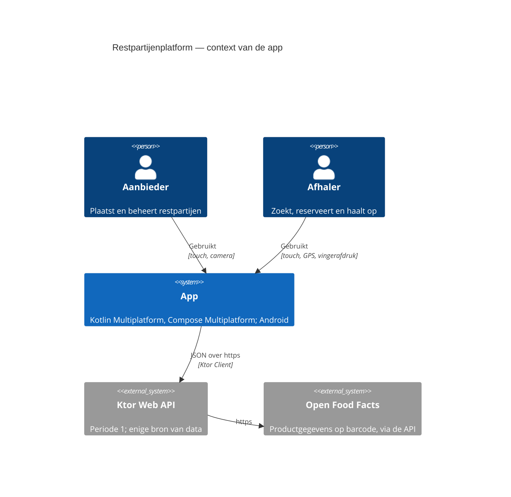
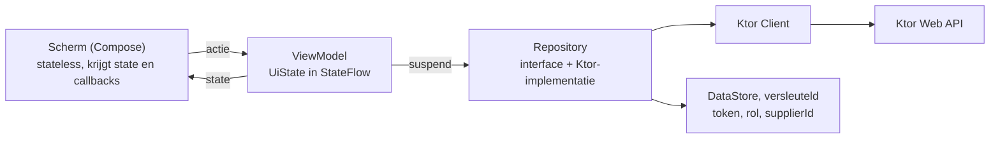
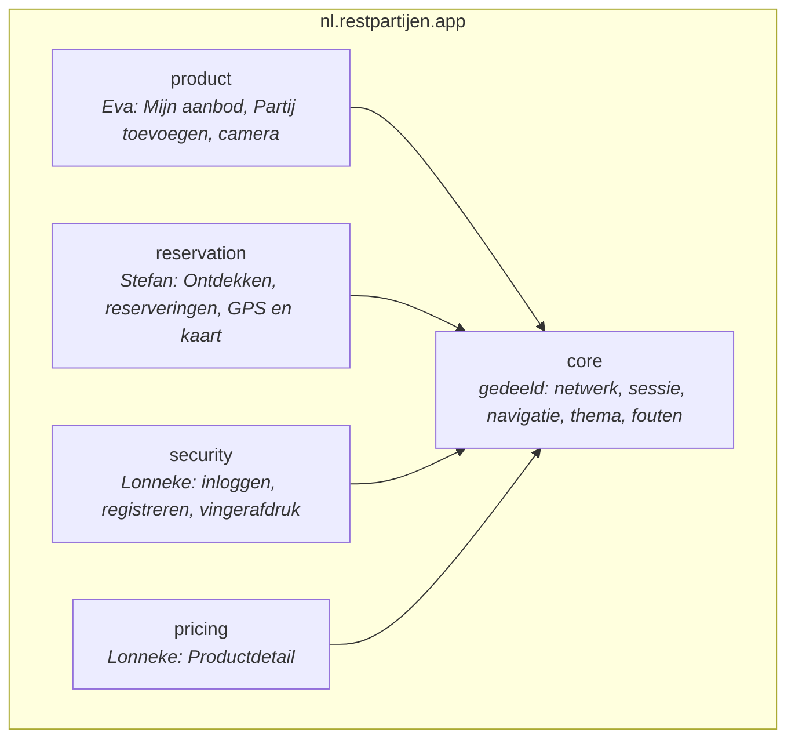

# Restpartijenplatform — Functioneel Technisch Ontwerp app

> **Leeswijzer.** Dit is het ontwerp van deel 2 van de proftaak: de app. Vanaf v2.0 is de app een Kotlin Multiplatform-project met Compose Multiplatform, met Android als target (A-03). Het is een los document naast het *Functioneel Technisch Ontwerp Web API* versie 3.0 (hierna: [[FTD-restpartijen-webapi-v3_0|FTD v3]]). Alles wat de API al vastlegt, staat hier niet opnieuw; FTD v3 wordt niet meer gewijzigd, en wat er aan de API verandert, staat in §12 (A-18). Een verwijzing als "[[FTD-restpartijen-webapi-v3_0#18.4 Request-flow tussen de app en de API|FTD v3 §18.4]]" wijst naar dat document. Het ontwerp groeit per feature mee: een feature is pas af als haar deel in dit document af is (A-02).

## Documentbeheer

| Veld | Waarde |
|------|--------|
| Document ID | FTD-restpartijen-app-v2.4 |
| Scenario | project |
| Auteurs | Eva Bouwman, Lonneke van Oers, Stefan Pellikaan |
| Datum | 2026-11-15 |
| Status | Concept. De besluiten van de startsessie van 14 november 2026 zijn verwerkt |
| Classificatie | Intern (schoolproject) |
| Module | AI-powered software development, periode 2, LU1 |
| Akkoord | Besluiten A-01 t/m A-19: profgroep en vakdocent, 7 t/m 10 november 2026. A-20 t/m A-28: profgroep, startsessie 14 november 2026. A-29 en A-30: Eva, 15 november 2026. Het document zelf: nog door Stefan en Lonneke te lezen |
| Hoort bij | [[FTD-restpartijen-webapi-v3_0\|FTD v3]]; [[besluiten-ftd-app]] |

## Revisiehistorie

| Versie | Datum | Auteur | Wijziging |
|--------|-------|--------|-----------|
| 1.0 | 2026-11-07 | Eva Bouwman, namens de profgroep | Eerste versie. Op 5 november voorbereid door Eva samen met Claude; de besluiten zijn op 7 november 2026 met Lonneke en Stefan besproken en daarna verwerkt |
| 1.1 | 2026-11-10 | Eva Bouwman, samen met Claude | Antwoord van de vakdocent van 8 november verwerkt: akkoord op CameraX, ML Kit en AndroidX Biometric (A-10, A-11) en op https (W-A1); bouwtool Kotlin Toolchain in IntelliJ IDEA (A-14); R-A1 vervallen, R-A2 vervangen; O-1 en O-2 afgehandeld |
| 1.2 | 2026-11-10 | Eva Bouwman, samen met Claude | §6 gelijkgetrokken met K-A2: US-05 staat op een eigen rij, bij het scherm Productdetail van Lonneke, met de `ReservationRepository` uit `core`; O-11 toegevoegd. Nieuw onderdeel GB-7 in §9: de coverage-meting, van Eva, af vóór haar eigen schermen; §2, §3, NFR-A3 en §18 daarop aangepast |
| 1.3 | 2026-11-10 | Eva Bouwman, samen met Claude | O-11 beslist: de UI-test voor reserveren met `409` hoort bij Lonneke, want een UI-test test een scherm en Productdetail is haar scherm. §6 en §13 aangepast. Voor Stefan staat in §13 een voorstel voor een andere foutsituatie op zijn eigen scherm; hij bevestigt dat (O-11) |
| 2.0 | 2026-11-10 | Eva Bouwman, samen met Claude | Overstap naar Kotlin Multiplatform met Compose Multiplatform, met Android als target, op advies van de vakdocent (A-03). Navigation 3 en Koin blijven, ook op advies van de vakdocent. Desktop als tweede target is overwogen en valt af (Eva, 10 nov). Gevolgen verwerkt in de besluiten (A-03, A-08, A-10 t/m A-14, nieuw A-19), §1, §5.8, §7, §8, §9, §10, §12.1, §13, §14, §17 en §18; nieuw §8.8 (platformcode). Eigen bestand volgens de versieregel; v1.3 blijft bestaan als [[ftd-restpartijen-android-app-v1-3]] |
| 2.1 | 2026-11-10 | Eva Bouwman, samen met Claude | A-19 aangepast op advies van de vakdocent: voor iconen hoeft de groep niet te kiezen tussen de Valkyrie-plugin en Compose Multiplatform resources; welke past, hangt af van de situatie |
| 2.2 | 2026-11-12 | Door Eva samen met Claude | Uitkomsten van de proef met de Kotlin Toolchain van 11 en 12 november verwerkt ([[eva-proef-kotlin-toolchain-android]]), met de besluiten van Eva. Geraakt: A-13, A-14, A-19, §3, §5.8, §6, §8.3, §8.4, §8.6, §8.7, §8.8, §9, §10, §11, §12, §13, §14, §15, §16, §17 en §19 |
| 2.3 | 2026-11-12 | Door Eva samen met Claude | Grote check van 12 november verwerkt ([[status-grote-check-ftd-draaiboek-codebase]]): fouten gecorrigeerd, de besluiten van Eva verwerkt en de tekst ingekort. Het token met vingerafdruk is onderbouwd in [[literaire-onderbouwing-token-en-vingerafdruk]]. Geraakt: A-13, §2, §5, §8.3, §8.6, §9, §10, §11.2, §11.3, §12.1, §13, §14, §16.3, §16.4, §16.6, §17, §19 en §20. R-A1, O-1 en O-2 zijn weg (afgehandeld) |
| 2.4 | 2026-11-14 | Door Eva samen met Claude | Besluiten van de startsessie van 14 november verwerkt ([[draaiboek-startsessie-android-v2]]; gebouwd in PR #88). Nieuw: A-20 t/m A-28 (beslispunten 1, 3, 4, 5, 7, 8, 9 en 10, en de vorm van K-A3). Bevestigd: A-13 en de antwoorden op O-7. Ingevuld: A-15 (design patterns). Geraakt: §5.7, §8.3, §8.5, §8.6, §8.8, §9, §11.2, §16.3 en §19.2 Aangevuld op 15 nov, bij het nalopen van het draaiboek van sessie 2: A-29 (Koin per feature, platformcode in `platformModule`), A-30 (token en `401` via de `Auth`-plugin), eigenaren van `formatPrice` en de toestemming voor het lokale netwerk, en O-17. Geraakt: §8.3, §8.6, §8.8, §9, §11.4, §16.1 en §19.2 |

## Besluiten

De nummering begint bij A-01, zodat zij niet botst met B-01 tot en met B-64 in FTD v3. De onderbouwing per besluit staat in [[besluiten-ftd-app]].

| # | Onderwerp | Besluit | Wie, wanneer | Status |
|---|-----------|---------|--------------|--------|
| A-01 | Planning | Fase 1 gezamenlijke basis 8–29 nov (18–22 nov persoonlijke ontwikkeling); fase 2 eigen features 30 nov–27 dec; alles af op 10 jan 2027; fase 3 finetunen en film 11–17 jan | Profgroep, 7 nov | Vast |
| A-02 | Definition of Done | Een feature is pas af als haar deel in dit document af is | Profgroep, 7 nov | Vast |
| A-03 | Platform | Kotlin Multiplatform met Compose Multiplatform. Target: Android. Desktop als tweede target is overwogen, maar valt af. iOS, desktop en web vallen buiten scope | Vakdocent, 10 nov (verving: alleen Android met Jetpack Compose, Eva 5 nov); desktop eruit: Eva, 10 nov | Vast |
| A-04 | Vorm van het ontwerp | Los document met verwijzingen naar FTD v3; zelfde werkwijze met revisiehistorie en besluitentabel | Profgroep, 7 nov | Vast |
| A-05 | Verdeling | Eva: Mijn aanbod, Partij toevoegen. Stefan: Ontdekken, Mijn reserveringen, Reserveringsdetail. Lonneke: Inloggen en registreren, Productdetail | Profgroep, 7 nov | Vast |
| A-06 | Sensoren | Camera (Eva), GPS (Stefan), vingerafdruk (Lonneke). De accelerometer uit [[FTD-restpartijen-webapi-v3_0#18.1 Sensoren\|FTD v3 §18.1]] vervalt als reserve | Profgroep, 7 nov | Vast |
| A-07 | HTTPS | De API krijgt https; taak in de gezamenlijke basis (GB-3). Uitwerking in §12 | Eva, 5 nov | Vast |
| A-08 | Technieken | De technieken uit de lessen zijn de standaard, in hun multiplatform-variant waar die bestaat (§8.6) | Eva, 5 nov; aangepast 10 nov (A-03) | Vast |
| A-09 | Architectuur | Drie lagen: scherm, ViewModel, repository; unidirectional data flow; geen MVI | Profgroep, 7 nov | Vast |
| A-10 | Camera en barcode | CameraX met ML Kit Barcode Scanning, gebundelde variant; niet de Google Code Scanner. Platformcode (§8.8) | Profgroep, 7 nov; akkoord vakdocent, 8 nov | Vast |
| A-11 | Vingerafdruk | AndroidX Biometric (`BiometricPrompt`); eerste keer met wachtwoord, daarna met vingerafdruk. Platformcode (§8.8) | Profgroep, 7 nov; akkoord vakdocent, 8 nov | Vast |
| A-12 | GPS en kaart | MapLibre Compose (multiplatform) met `FusedLocationProviderClient` | Vakdocent, september ([[FTD-restpartijen-webapi-v3_0#20. Terugkoppeling van de vakdocent\|FTD v3 §20]]) | Vast |
| A-13 | Token bewaren | Het token versleuteld bewaren: een DataStore met `datastore-tink`, de sleutel beschermd door de Android Keystore (§16.3). Bewezen in de proef van 12 nov. Er is geen terugval naar onversleuteld bewaren. Lonneke bouwt het (GB-3) | Profgroep, 7 nov; vorm aangepast door Eva, 12 nov (was: Preferences DataStore, met een terugval en beslisdatum 20 dec); optie B voor de vingerafdruk bevestigd door Lonneke, 14 nov (§16.3) | Vast |
| A-14 | Modules en packages | Zelfde repository. Een gedeelde module (`kmp/lib`, platform Android) met packages per feature, plus een dunne Android-app (`android/app`) (§8.3). Bouwtool en IDE: Kotlin Toolchain in IntelliJ IDEA, op advies van de vakdocent. Terugval: omzetten naar Gradle met ktc-to-gradle | Profgroep, 7 nov; bouwtool vakdocent, 8 nov; twee modules 10 nov (A-03); namen `shared` en `android`: Eva, 12 nov | Vast |
| A-15 | Design patterns | Ieder kiest 2 patterns (1 in eigen code, 1 herkend in een library), zonder dubbele. MVVM, Repository en DI tellen niet mee. Gekozen: Lonneke State en Builder; Stefan Adapter en Facade; Eva Strategy (barcode scannen of handmatig invoeren) en Chain of Responsibility (de plugins van de Ktor Client). Waar ze in de code komen: [[besluiten-ftd-app#Gekozen design patterns (14 nov)]] | Profgroep, 7 nov; keuze 14 nov | Vast |
| A-16 | Wireframes | Gegenereerd uit de user stories en [[FTD-restpartijen-webapi-v3_0#18.4 Request-flow tussen de app en de API\|FTD v3 §18.4]], daarna door ieder gecontroleerd; klaar vóór 30 nov | Profgroep, 7 nov | Vast; volgt |
| A-17 | Testen | Test-driven; unit tests voor ViewModels en repository's, UI-tests op de stateless schermen; sensoren vervangen door nepinvoer; seeddata van de API als testdata (§13) | Eva, 5 nov | Vast |
| A-18 | FTD v3 bevroren | FTD v3 wordt niet meer gewijzigd en blijft de bron voor de API. Elke wijziging aan de API staat in §12 van dit document, met het nummer van de paragraaf in FTD v3 die erdoor achterhaald is | Eva, 7 nov | Vast |
| A-19 | Iconen | Standaard: iconen als Android-XML in `composeResources/drawable/`, getoond met `painterResource`. De Valkyrie-plugin (SVG naar `ImageVector` in Kotlin-code) alleen als we het pad in code bewerken. Uitwerking in §8.6 | Advies vakdocent, 10 nov: welke past, hangt af van de use case. Uitgewerkt naar best practice (Eva, 12 nov) | Vast |
| A-20 | Packagenaam | `nl.restpartijen.app`, ook als `namespace` en `applicationId` van de Android-app (§8.3). De server heet `com.restpartijen.api` | Startsessie, 14 nov (beslispunt 1) | Vast |
| A-21 | Standaardtaal | Engels in `composeResources/values/`, Nederlands in `composeResources/values-nl/`. Een toestel in een andere taal krijgt Engels | Startsessie, 14 nov (beslispunt 3) | Vast |
| A-22 | Fouten uit een repository | Een repository geeft een `ApiResult` terug (`Success` of `Failure`), geen exceptie. `ApiError` is sealed: `Http(status, message, field?)` als de server een fout geeft, en `Network` als er geen antwoord kwam (§11.2) | Startsessie, 14 nov (beslispunt 4); vorm van `ApiError`: Stefan | Vast |
| A-23 | Waar de schermen samenkomen | Routes in `core.navigation`; de koppeling van route aan scherm in `AppNavigation.kt` bovenin `shared`, naast `App()`: de enige plek die alle features kent, zoals `module()` op de server | Startsessie, 14 nov (beslispunt 5) | Vast |
| A-24 | App-model van een feature | Staat in `data` van die feature, niet in `core.model`. Alleen types die meerdere features delen, staan in `core.model` (§8.3) | Startsessie, 14 nov (beslispunt 7) | Vast |
| A-25 | Bedragen | Een bedrag is een `Long` in centen, zoals `reservedPriceInCents`; dezelfde regel als B-13 op de server | Startsessie, 14 nov (beslispunt 8) | Vast |
| A-26 | Platformcode | Android-code staat in `src@android/`, gedeelde code in `src/` (§8.8) | Startsessie, 14 nov (beslispunt 9) | Vast |
| A-27 | Inloggen en terug (K-A3) | Een ViewModel meldt "inloggen nodig" als toestand in de UiState, niet als losse gebeurtenis. De ViewModel onthoudt de actie die wacht en voert haar uit zodra `SessionStore.session` niet meer `null` is (§8.5) | Startsessie, 14 nov | Vast |
| A-28 | Prijsweergave | Een prijs staat altijd in euro, ook in de Engelse interface. De notatie (decimaalteken, plek van het €-teken) volgt de taal van het toestel: EN `€2.39`, NL `€ 2,39`. De prijs komt binnen als centen (A-25) en wordt op één plek in `core` omgezet naar tekst (`formatPrice`); Lonneke bouwt die (GB-3, Eva 15 nov) | Startsessie, 14 nov (beslispunt 10) | Vast |
| A-29 | Koin-modules | Een Koin-module per feature en één `coreModule`, samengevoegd in `appModule` met `includes()`; `startKoin` laadt alleen `appModule`. De Android-implementaties staan per feature in een platform-module in `src@android/`, samen in `platformModule`, die `RestpartijenApplication` naast `appModule` laadt. Koin raadt `includes()` aan en laat meerdere modules aan `startKoin` toe (Koin, z.j.-a). Code in `src/` kan geen klasse uit `src@android/` zien, en met een module per feature schrijft ieder alleen in de eigen feature (§8.3, §8.8). `expect`/`actual` (Koin, z.j.-b) werkt met de toolchain, maar IntelliJ markeert het bij één platform als fout; daarom niet gebruikt (`docs/tooling-issues/`). Eva bouwde het geraamte op 15 nov (GB-1) | Eva, 15 nov | Vast |
| A-30 | Token en `401` | De `Auth`-plugin van de Ktor Client met `bearer`: `loadTokens` leest het token uit `SessionStore`, `sendWithoutRequest` stuurt het direct mee, en `refreshTokens` wist de sessie, want er zijn geen refresh tokens. Een `401` op `POST /auth/login` is een verkeerd wachtwoord en wist niets (§5.6). Dit is de standaard van Ktor hiervoor (JetBrains, z.j.-k). Lonneke bouwt het (GB-3) | Eva, 15 nov | Vast; het overslaan van het login-request nog te bewijzen met een test |

## Inhoudsopgave

1. Scope en doelstellingen
2. Betrokkenen en verdeling
3. Planning en werkwijze
4. User stories
5. Acceptatiecriteria
6. Traceability matrix
7. Definition of Done
8. Architectuur
9. Gezamenlijke basis
10. Sensoren
11. API en integratie
12. Wijzigingen aan de Web API
13. Teststrategie
14. Niet-functionele eisen (NFR)
15. Privacy by design
16. Security by design
17. Risico's
18. Begrippenlijst
19. Weggelaten secties en open punten
20. Bronnen

## 1. Scope en doelstellingen

### 1.1 Probleemstelling

De Web API uit periode 1 werkt, maar is alleen met een HTTP-client te bedienen. Een aanbieder in de winkel en een afhaler onderweg hebben een telefoon, geen IntelliJ. Zonder app bereikt het platform zijn gebruikers niet, en blijven de sensoren die de casus sterk maken (barcode scannen, aanbod in de buurt) onbenut.

### 1.2 Doel

Een app in Kotlin Multiplatform met Compose Multiplatform, met Android als target, waarmee een aanbieder restpartijen plaatst en beheert, en een afhaler aanbod in de buurt vindt, reserveert en het ophalen bevestigt. De app gebruikt de Ktor API uit periode 1 als enige bron van data ([[FTD-restpartijen-webapi-v3_0#18.3 Wat de API nu al biedt voor periode 2|FTD v3 §18.3]]).

### 1.3 In scope

- Drie tabs met detailschermen, samen zeven schermen ([[FTD-restpartijen-webapi-v3_0#18.2 Navigatiestructuur|FTD v3 §18.2]]), plus een inlogscherm.
- De user stories US-01 t/m US-07, US-10 en US-11 uit FTD v3, nu als schermen in de app, en drie nieuwe stories voor inloggen (§4.2).
- Kotlin Multiplatform met Android als target; schermen en logica staan in de gedeelde module (A-03).
- Drie sensoren: camera, GPS en vingerafdruk (A-06).
- Nederlandse en Engelse gebruikersinterface; code en commentaar in het Engels.
- Https op de Ktor API (A-07).
- Unit tests en UI-tests (§13).

### 1.4 Buiten scope

- De beheerfuncties US-08 en US-09. Zij blijven bereikbaar via de HTTP-client van IntelliJ ([[FTD-restpartijen-webapi-v3_0#18.4 Request-flow tussen de app en de API|FTD v3 §18.4]]).
- Een grafiek met het prijsverloop. Lonneke koos voor inloggen en registreren ([[FTD-restpartijen-webapi-v3_0#21. Open punten|FTD v3 §21]]).
- iOS, desktop en web als target, Room, offline werken, navigatie per rol, en alles wat [[FTD-restpartijen-webapi-v3_0#1.6 Buiten scope|FTD v3 §1.6]] al uitsluit.

### 1.5 Succescriteria

- Elke use case uit [[FTD-restpartijen-webapi-v3_0#18.4 Request-flow tussen de app en de API|FTD v3 §18.4]] is in de app te doorlopen en staat in de demofilm.
- De drie sensoren werken in de gebruikersflow op de emulator en op een echte telefoon.
- Per student minimaal drie unit tests; voor de app minimaal drie UI-tests (toetsdocument, deel 2).
- Per student twee design patterns, met klassen- en sequencediagram (A-15).
- Alles werkt op 10 januari 2027; inleveren uiterlijk 17 januari 2027 (A-01).

## 2. Betrokkenen en verdeling

| Wie | Rol | Schermen | Endpoints ([[FTD-restpartijen-webapi-v3_0#10.1 Endpoints\|FTD v3 §10.1]]) | Sensor | Gezamenlijke basis |
|-----|-----|----------|--------------------------|--------|--------------------|
| Eva Bouwman | Student, F1 | Mijn aanbod, Partij toevoegen | `GET /products/lookup/{barcode}`, `POST /products`, `PUT` en `DELETE /products/{id}`, `GET /suppliers/{id}/products`, `GET` en `PUT /suppliers/{id}/opening-hours` | Camera | GB-1, GB-7 |
| Stefan Pellikaan | Student, F2 | Ontdekken (lijst en kaart), Mijn reserveringen, Reserveringsdetail | `GET /products`, `POST` en `GET /reservations`, `DELETE /reservations/{id}`, `POST /reservations/{id}/collect` | GPS | GB-2 |
| Lonneke van Oers | Student, F3 | Inloggen en registreren, Productdetail | `POST /auth/login`, `POST /auth/register`, `GET /products/{id}` | Vingerafdruk | GB-3 |
| Paul de Mast | Vakdocent, assessor | Beoordeelt sensoren, libraries buiten de lessen en de bouwtool (§19) | | | |

Verantwoordelijkheden volgen de verdeling: ieder is verantwoordelijk voor de eigen schermen, inclusief tests en het deel in dit document. Besluiten over de gezamenlijke basis en de koppelvlakken neemt de profgroep samen. Een aparte RACI-matrix voegt daar niets aan toe.

De gebruikersrollen zijn die van de API: afhaler, aanbieder en beheerder ([[FTD-restpartijen-webapi-v3_0#1.3 Doelgroep|FTD v3 §1.3]]). De app heeft geen beheerschermen. Zonder inloggen kan een gebruiker zoeken en een partij bekijken; bij de eerste actie die een rol vraagt, verschijnt het inlogscherm ([[FTD-restpartijen-webapi-v3_0#18.4 Request-flow tussen de app en de API|FTD v3 §18.4]]).

## 3. Planning en werkwijze

| Fase | Periode | Inhoud |
|------|---------|--------|
| 0 | t/m 7 nov | Besluiten en dit document (v1.0) |
| 1 | 8 t/m 29 nov | Gezamenlijke basis GB-1 t/m GB-7 (§9). 18 t/m 22 nov: persoonlijke ontwikkeling, geen werk aan de basis |
| 2 | 30 nov t/m 27 dec | Ieder de eigen schermen en sensor |
| Buffer | 28 dec t/m 10 jan | Uitloop en ziekte; alles af op 10 jan |
| 3 | 11 t/m 17 jan | Finetunen, demofilm, inleveren |

**Gezamenlijke basis (besluit Eva, 12 nov).** Zaterdag 14 november bouwen we samen de gezamenlijke basis ([[draaiboek-startsessie-android-v2]]). Ongeveer twee weken later heeft ieder het eigen gedeelde deel af (GB-1, GB-2, GB-3, GB-7). Daarna werkt ieder verder op een eigen branch. Dit past binnen fase 1.

In periode 1 werd het einde een race tegen de klok. Daarom is de buffer geen werktijd en is een feature pas af als haar deel in dit document af is (A-02). De profgroep overlegt elke zaterdag online en werkt dinsdags samen op school.

## 4. User stories

Format: "Als *rol*, wil ik *actie*, zodat *waarde*". De stories uit periode 1 zijn niet herschreven; de app geeft ze een scherm.

### 4.1 Stories uit FTD v3

US-01 t/m US-07, US-10 en US-11 krijgen een scherm in de app. Welke story op welk scherm landt en van wie het is, staat in de traceability matrix (§6). US-08 en US-09 blijven buiten de app (§1.4).

### 4.2 Nieuwe stories (Lonneke)

**US-12 — Inloggen**
Als **gebruiker** wil ik inloggen met mijn e-mailadres en wachtwoord, zodat ik kan reserveren of mijn aanbod kan beheren.
*Prioriteit: Must.* INVEST: onafhankelijk van de andere schermen; waarde voor elke actie die een rol vraagt; klein (één scherm, één endpoint); testbaar met een nep-repository.

**US-13 — Account aanmaken**
Als **nieuwe gebruiker** wil ik een account aanmaken met e-mailadres, wachtwoord en weergavenaam, zodat ik partijen kan reserveren.
*Prioriteit: Must.* INVEST: zelfde scherm als US-12 maar een eigen flow; een nieuw account is altijd een afhaler ([[FTD-restpartijen-webapi-v3_0#GI-3 Authenticatie en rollen — uitvoering: Lonneke|FTD v3 GI-3, besluit 3.7]]).

**US-14 — Inloggen met vingerafdruk**
Als **gebruiker die al eens is ingelogd** wil ik de app met mijn vingerafdruk ontgrendelen, zodat ik niet elke keer mijn wachtwoord hoef in te typen.
*Prioriteit: Should.* INVEST: bouwt op US-12 en op het bewaarde token (A-13); valt zonder gevolgen terug op wachtwoord als het toestel geen biometrie heeft. De API verandert niet.

## 5. Acceptatiecriteria
<!-- ac-format: bullets -->

De criteria beschrijven wat de app doet. Wat de API teruggeeft, staat in [[FTD-restpartijen-webapi-v3_0#5. Acceptatiecriteria|FTD v3 §5]] en [[FTD-restpartijen-webapi-v3_0#18.4 Request-flow tussen de app en de API|§18.4]] en wordt hier niet herhaald.

### 5.1 Partij toevoegen (US-01, US-02 — Eva)

- Na het scannen van een geldige barcode zijn de velden productnaam en allergenen voorgevuld met het antwoord van `GET /products/lookup/{barcode}`.
- Bij `404`, een leeg antwoord of `manualEntryRequired` blijft het formulier leeg en kan de aanbieder alles zelf invullen; plaatsen blijft mogelijk.
- Zonder cameratoestemming toont het scherm een uitleg en een knop "Handmatig invoeren".
- Een lege productnaam geeft een melding bij het veld voordat er een request gaat.
- Bij `422` toont de app een eigen tekst bij het veld dat `field` noemt (§11.2).
- Bij `201` gaat de app terug naar Mijn aanbod en staat de nieuwe partij in de lijst.

### 5.2 Mijn aanbod (US-03, US-10 — Eva)

- Het scherm toont de partijen met status `LISTED` en `RESERVED` van de ingelogde aanbieder, met naam, actuele prijs en afhaalvenster.
- Een `LISTED` partij is te wijzigen en te verwijderen; bij een `RESERVED` partij zijn beide acties uitgeschakeld, met uitleg.
- De openingstijden zijn per dag te bekijken en te wijzigen; bij `422` toont de app een eigen tekst bij de betreffende dag.

### 5.3 Ontdekken (US-04 — Stefan)

- De lijst toont per partij naam, productsoort, actuele prijs, resterende houdbaarheid en de afstand tot de gebruiker.
- Filteren op productsoort, maximumprijs en minimale houdbaarheid stuurt de filters mee in `GET /products`; de lijst toont alleen passende partijen.
- Zonder locatietoestemming toont de lijst geen afstand en toont de kaart geen eigen positie; de rest werkt.
- De kaart toont elke aanbieder uit het resultaat als marker op de eigen coördinaten; tikken op een marker opent Productdetail.

### 5.4 Productdetail (US-07, US-05 — Lonneke, Stefan)

- Het scherm toont oorspronkelijke prijs, kortingspercentage en actuele prijs, zoals de API ze geeft.
- Een partij met status `EXPIRED` toont "niet meer beschikbaar" en geen knop "Reserveren".
- "Reserveren" zonder geldig token opent het inlogscherm; na inloggen keert de app terug naar dit scherm en voert de reservering alsnog uit.
- Bij `201` toont de app de reservering met de vastgelegde prijs en het afhaalvenster; bij `409` een melding en daarna ververste gegevens.

### 5.5 Mijn reserveringen en Reserveringsdetail (US-06, US-11 — Stefan)

- De lijst toont de eigen reserveringen, de nieuwste eerst, met status en afhaalvenster.
- Intrekken vraagt om bevestiging; bij `204` verdwijnt de reservering uit de lijst; bij `409` legt de melding uit dat zij al is afgehandeld.
- Ophalen bevestigen toont bij `200` een bevestigingsscherm dat de aanbieder kan zien; bij `422` meldt de app dat het moment buiten het afhaalvenster valt.

### 5.6 Inloggen en registreren (US-12, US-13 — Lonneke)

- Inloggen met een juist e-mailadres en wachtwoord bewaart het token, de rol en bij een aanbieder het `supplierId`, en gaat terug naar de actie waar de gebruiker mee bezig was.
- Bij `401` toont de app één melding ("e-mailadres of wachtwoord klopt niet") zonder te zeggen welk veld fout is.
- Registreren met een wachtwoord korter dan 8 tekens toont de melding bij het veld (`400` met `field`, [[FTD-restpartijen-webapi-v3_0#Besluiten in v3.0|FTD v3 B-56]]); bij `409` meldt de app dat het e-mailadres al bestaat.
- Na `201` bij registreren logt de app de gebruiker direct in.
- Uitloggen wist het token; de app toont daarna weer alleen de openbare schermen.

### 5.7 Inloggen met vingerafdruk (US-14 — Lonneke)

- Bij het openen van de app met een bewaard token vraagt de app om een vingerafdruk; na herkenning is de gebruiker ingelogd zonder wachtwoord.
- Mislukt de herkenning, of heeft het toestel geen biometrie, dan toont de app het gewone inlogscherm.
- Na de eerste keer inloggen met het wachtwoord biedt de app de vingerafdruk aan. Zegt de gebruiker ja, dan is meteen een vingerafdruk nodig om het token op te slaan (§16.3). Zegt hij nee, dan bewaart de app het token niet (Lonneke, 14 nov).
- Klikt de gebruiker de vraag om een vingerafdruk weg, dan gaat hij verder als bezoeker: zoeken kan zonder inloggen (§2). Een actie die een rol vraagt, opent het inlogscherm (K-A3) (Lonneke, 14 nov).
- Is het bewaarde token verlopen (`401` bij de eerstvolgende aanroep), dan wist de app het token en vraagt zij om het wachtwoord.

### 5.8 Geldt voor alle schermen

- Elke tekst in de interface komt uit de resources (`strings.xml` in `composeResources`) en is in het Nederlands en het Engels beschikbaar; de taal volgt het toestel.
- Draaien van het scherm verliest geen ingevulde invoer en geen geladen lijst.
- Tijdens het laden toont het scherm een voortgangsindicator. Een fout toont altijd een eigen tekst uit `strings.xml`, in het Nederlands en het Engels (§11.2). De `message` uit het foutmodel ([[FTD-restpartijen-webapi-v3_0#10.2 Validatie en foutafhandeling|FTD v3 §10.2]]) is Engels; de app toont hem nooit en schrijft hem alleen naar de log.

## 6. Traceability matrix

| Story | Scherm | ViewModel en repository | Endpoint | Test | Eigenaar |
|-------|--------|-------------------------|----------|------|----------|
| US-01, US-02 | Partij toevoegen | `AddProductViewModel`, `ProductRepository`, `BarcodeScanner` | `GET /products/lookup/{barcode}`, `POST /products` | UT-E1, UI-E1 | Eva |
| US-03, US-10 | Mijn aanbod | `MyOfferViewModel`, `ProductRepository`, `OpeningHoursRepository` | `GET /suppliers/{id}/products`, `PUT`/`DELETE /products/{id}`, `GET`/`PUT /suppliers/{id}/opening-hours` | UT-E2, UI-E2 | Eva |
| US-04 | Ontdekken | `DiscoverViewModel`, `SearchRepository`, `LocationProvider` | `GET /products` | UT-S1, UI-S1 | Stefan |
| US-05 | Productdetail (knop "Reserveren") | `ProductDetailViewModel` roept `ReservationRepository` uit `core` aan (K-A2) | `POST /reservations` | UT-S2 (repository, Stefan); UI-L1 (knop en `409`, Lonneke) | Lonneke: knop en ViewModel. Stefan: de repository |
| US-06, US-11 | Mijn reserveringen, Reserveringsdetail | `ReservationViewModel`, `ReservationRepository` | `GET /reservations`, `DELETE /reservations/{id}`, `POST /reservations/{id}/collect` | UT-S2, UI-S2 | Stefan |
| US-07 | Productdetail | `ProductDetailViewModel`, `ProductDetailRepository` | `GET /products/{id}` | UT-L1, UI-L1 | Lonneke |
| US-12, US-13 | Inloggen en registreren | `AuthViewModel`, `AuthRepository`, `SessionStore` | `POST /auth/login`, `POST /auth/register` | UT-L2, UI-L2 | Lonneke |
| US-14 | Inloggen (vingerafdruk) | `AuthViewModel`, `BiometricUnlock`, `SessionStore` | geen | UT-L3 | Lonneke |

Productdetail is één scherm met één ViewModel, en het scherm is van Lonneke (A-05). De knop "Reserveren" hoort daarom bij haar; wat de knop doet, zit in de `ReservationRepository` van Stefan. Zo gebruikt de ene feature de andere niet rechtstreeks (§8.3, K-A2). Productdetail heeft een eigen repository in `pricing/data`, zodat features los blijven van elkaar (§8.3).

De klassennamen zijn een voorstel. Ieder werkt de eigen rij uit in het klassendiagram van de eigen feature (§19, open punt O-5).

## 7. Definition of Done

Een story is af als:

- [ ] De code is gemerged via een pull request met minimaal één review door een groepsgenoot.
- [ ] De unit tests voor de ViewModel en de repository zijn groen, inclusief minimaal één foutsituatie.
- [ ] De UI-test voor de hoofdactie van de story is groen (§13).
- [ ] Alle acceptatiecriteria uit §5 zijn aantoonbaar gehaald, op de emulator.
- [ ] Alle teksten staan in `strings.xml` in NL en EN.
- [ ] ktlint geeft geen meldingen en de build heeft geen warnings.
- [ ] Het deel van deze story in dit document is bijgewerkt: acceptatiecriteria, traceability, klassendiagram (A-02).
- [ ] De eigenaar kan de code, de keuzes en de testaanpak zelfstandig toelichten.
- [ ] Het gebruik van AI-tooling bij deze story staat in het AI-logboek.

## 8. Architectuur

### 8.1 Context (C4 niveau 1)



De app praat alleen met de eigen API. Open Food Facts bereikt zij nooit rechtstreeks: de lookup loopt via `GET /products/lookup/{barcode}` ([[FTD-restpartijen-webapi-v3_0#10.3 Integratie met Open Food Facts|FTD v3 §10.3]]). De kaarttegels van MapLibre komen van een tegelserver; dat is de enige andere externe verbinding (§10).

### 8.2 Drie lagen en unidirectional data flow (A-09, tevens containerniveau C4)

Een scherm toont de state en stuurt acties naar de ViewModel. De ViewModel verwerkt de actie, vraagt de repository om data en zet de nieuwe state in een `StateFlow`. Het scherm tekent zichzelf opnieuw. Data stroomt dus één kant op; een scherm wijzigt nooit zelf data. Dit is de opbouw die Google aanraadt en die de lessen 10 t/m 12 behandelen (Android Developers, z.j.-a). ViewModel en lifecycle komen uit de multiplatform-variant van Jetpack Lifecycle (JetBrains, z.j.-d).



Dit is de scheiding tussen UI en logica die de toets vraagt: het scherm bevat geen bedrijfsregels, de ViewModel bevat geen Compose, en de repository is een interface die in tests door een nep-implementatie wordt vervangen. MVI is overwogen en afgewezen: het voegt voor deze omvang alleen ceremonie toe en zit niet in de lessen.

### 8.3 Modules en packages (A-14)

Het project heeft twee modules (JetBrains, z.j.-c). De namen zijn `shared` en `android` (Eva, 12 nov). In `project.yaml` staan ze naast `server`.

| Module | Soort (`product`) | Inhoud |
|--------|-------------------|--------|
| `shared` | `kmp/lib`, platform `android` | Alle schermen, ViewModels, repository's en `core`. Code die een Android-library nodig heeft, staat in een eigen map (§8.8) |
| `android` | `android/app` | `MainActivity` en de `Application`-klasse die Koin start: start de gedeelde app op Android. Ook het manifest en `res/xml` (netwerk- en back-upregels) |

De Android-app is dun: zij doet alleen het opstarten. Alles wat getest moet worden, staat in `shared`. Binnen `shared` gelden de packages hieronder.



Elke featurepackage heeft `ui` (schermen en ViewModels) en `data` (repository, DTO's, sensoradapter). Code die een Android-library nodig heeft, zoals de camera, staat in `src@android` (§8.8). Features gebruiken `core`, nooit elkaar; wat de ene feature van de andere nodig heeft, loopt via navigatie-argumenten of via een interface in `core` (§8.5). De indeling spiegelt de API ([[FTD-restpartijen-webapi-v3_0#8.3 Packagestructuur|FTD v3 §8.3]]), zodat bij het assessment direct te zien is welke code van wie is. De packagenaam is `nl.restpartijen.app` (A-20).

De doelstructuur van de codebase:

```
restpartijen-api/
├── server/                          bestaande Ktor-API
├── shared/                          kmp/lib, platform android
│   ├── module.yaml
│   ├── composeResources/
│   │   ├── drawable/                iconen en het logo als Android-XML (A-19)
│   │   ├── font/                    Montserrat en Inter, Regular en Bold (§8.6)
│   │   ├── values/strings.xml       Engels, de standaardtaal (A-21)
│   │   └── values-nl/strings.xml    Nederlands
│   ├── src/<package>/               nl.restpartijen.app (A-20)
│   │   ├── App.kt                   Scaffold + NavDisplay
│   │   ├── AppNavigation.kt         routes → schermen (A-23)
│   │   ├── AppModule.kt             Koin: voegt de modules van core en de features samen (A-29)
│   │   ├── core/                    gedeeld, iedereen
│   │   │   ├── network/             HttpClient (GB-1), ApiResult en ApiError (A-22)
│   │   │   ├── session/             SessionStore-interface + nepversie (GB-3, K-A4)
│   │   │   ├── navigation/          routes/NavKeys, inlog-terugkeer (GB-2, K-A3)
│   │   │   ├── error/               fout → melding (GB-2)
│   │   │   ├── theme/               Material 3-thema (GB-5)
│   │   │   ├── ui/                  gedeelde laad- en foutonderdelen (GB-5)
│   │   │   ├── model/               gedeelde types: Role, Session, Reservation (A-24)
│   │   │   └── reservation/         ReservationRepository-interface + nepversie (K-A2)
│   │   ├── product/                 Eva: Mijn aanbod, Partij toevoegen
│   │   │   ├── ui/                  schermen + ViewModels
│   │   │   └── data/                ProductRepository, OpeningHoursRepository, DTO's, BarcodeScanner-interface
│   │   ├── reservation/             Stefan: Ontdekken, reserveringen, GPS en kaart
│   │   │   ├── ui/
│   │   │   └── data/                SearchRepository, ReservationRepository-implementatie, LocationProvider-interface
│   │   ├── security/                Lonneke: inloggen, registreren, vingerafdruk
│   │   │   ├── ui/
│   │   │   └── data/                AuthRepository, BiometricUnlock-interface
│   │   ├── pricing/                 Lonneke: Productdetail
│   │   │   ├── ui/
│   │   │   └── data/                ProductDetailRepository
│   │   └── example/                 tijdelijk: het voorbeeld van de startsessie; weg vóór inlevering
│   ├── src@android/<package>/       Android-implementaties (§8.8, A-26)
│   │   ├── core/session/            EncryptedSessionStore
│   │   ├── product/data/            BarcodeScanner met CameraX + ML Kit
│   │   ├── reservation/data/        LocationProvider
│   │   └── security/data/           BiometricUnlock met AndroidX Biometric
│   └── test/<package>/              zelfde packages als src/
├── android/                         android/app, alleen opstarten
│   ├── module.yaml
│   ├── src/
│   │   ├── AndroidManifest.xml
│   │   └── <package>/               MainActivity.kt, RestpartijenApplication.kt
│   └── res/                         xml/ (netwerk- en back-upregels), app-icoon (mipmap/, drawable/, values/colors.xml)
├── project.yaml                     modules: android, server, shared
├── libs.versions.toml
├── coverage.sh/.bat                 server
└── coverage-shared.sh/.bat          shared (GB-7)
```

Elke feature en `core` hebben een eigen Koin-module (A-29); de Android-implementaties staan in een platform-module in `src@android/`. Een interface die maar één feature gebruikt, staat in `data/` van die feature. Interfaces die meerdere features gebruiken (`SessionStore`, `ReservationRepository`), staan in `core`. De nepversie van zo'n interface staat ernaast in `src/`, zolang de echte versie er nog niet is. Is de echte versie af, dan verhuist de nepversie naar `test/`, net als bij de server. `test/` volgt dezelfde packages als `src/`, de gangbare conventie. De besluiten van de startsessie staan als (A-nummer).

**Geen vaste domain-laag.** Elke feature heeft alleen `ui` en `data`. Google noemt een domain-laag met use cases optioneel: die is alleen nodig als meerdere ViewModels dezelfde bedrijfslogica gebruiken, of als één ViewModel te complex wordt (Android Developers, z.j.-r). In onze app rekent de server prijs en korting uit ([[FTD-restpartijen-webapi-v3_0#Besluiten van de startsessie en daarna (v2.2)|FTD v3, B-24]]), en rekent de repository euro's één keer om naar centen (§11.1). Ontstaat er toch zulke logica, dan krijgt die feature een map `domain/` met een `…UseCase`-klasse. Logica die meerdere features delen, gaat naar `core`.

### 8.4 Navigatie

Navigation 3 met een bottom navigation van drie tabs: Ontdekken, Reserveringen, Mijn aanbod ([[FTD-restpartijen-webapi-v3_0#18.2 Navigatiestructuur|FTD v3 §18.2]]). Elk scherm is een route met een eigen `NavKey`; het inlogscherm is een route die bovenop elke tab kan verschijnen en na succes terugkeert naar de route die hem opende. Navigation 3 is nieuw (stabiel sinds november 2025); AI-tools en oudere voorbeelden leveren vaak code voor de oudere Navigation Compose. Dat is een vast punt in de AI-verantwoording: elke suggestie wordt tegen de actuele documentatie gecontroleerd.

We gebruiken de multiplatform-variant van Navigation 3 (`org.jetbrains.androidx.navigation3:navigation3-ui`), versie 1.2.0 (JetBrains, z.j.-d). De proef van 11 nov liet twee dingen zien. Eén: zonder extra instelling hangt elke ViewModel aan de Activity, niet aan het scherm. Daarom krijgt `NavDisplay` vanaf het begin twee decorators: `rememberSaveableStateHolderNavEntryDecorator()` en `rememberViewModelStoreNavEntryDecorator()` uit `lifecycle-viewmodel-navigation3`. Twee: een `SavedStateConfiguration` met alle routes is niet nodig, omdat Android het enige target is. Een scherm krijgt een `onBack`-callback, niet de back stack ([[eva-proef-kotlin-toolchain-android]]).

### 8.5 Koppelvlakken tussen de features

| # | Van | Naar | Afspraak |
|---|-----|------|----------|
| K-A1 | Ontdekken (Stefan) | Productdetail (Lonneke) | De route krijgt het `productId` als argument; niets anders |
| K-A2 | Productdetail (Lonneke) | Reserveren (Stefan) | Lonneke tekent de knop; de knop roept `ReservationRepository.reserve(productId)` uit `core` aan, die Stefan implementeert |
| K-A3 | Elke actie die een rol vraagt | Inloggen (Lonneke) | Bij ontbrekend token of `401` zet de navigatie `LoginRoute` bovenop de back stack; het scherm eronder blijft staan. Na een geslaagde login gaat `LoginRoute` eraf en voert het scherm de actie alsnog uit. Uitwerking hieronder (A-27) |
| K-A4 | Inloggen (Lonneke) | Mijn aanbod (Eva) | Na inloggen staan rol en `supplierId` in `SessionStore` in `core`; Mijn aanbod leest het `supplierId` daar |

De afspraken staan als code in `core` (PR #88): `ProductDetailRoute(productId)` en `LoginRoute` in `core.navigation`, `ReservationRepository` in `core.reservation` en `SessionStore` in `core.session`, elk met een nepversie in `src/` tot de echte versie af is.

**K-A3 in code (A-27).** Een ViewModel meldt "inloggen nodig" als toestand: de UiState krijgt een veld zoals `loginRequired = true`. Het scherm ziet dat, roept zijn callback `onLoginRequired()` aan en meldt de ViewModel dat het is afgehandeld. Google raadt aan een gebeurtenis uit de ViewModel altijd als update van de UI-state te geven, en noemt een `Channel` daarvoor een anti-pattern: de gebeurtenis kan verloren gaan (Android Developers, z.j.-s). De ViewModel onthoudt de actie die wacht, bijvoorbeeld `reserve(42)`, en luistert naar `SessionStore.session`; wordt die niet-`null`, dan voert hij de actie uit. Dat werkt omdat de ViewModel onder het inlogscherm blijft bestaan, dankzij de decorators van §8.4. Stefan (GB-2) en Lonneke (GB-3) bouwen dit.

### 8.6 Technische keuzes (A-08)

| Keuze | Waarom | Alternatief, afgewezen omdat |
|-------|--------|------------------------------|
| Compose Multiplatform, Material 3 | Advies van de vakdocent (A-03). De API is gelijk aan die van Jetpack Compose uit de lessen. Compose 1.12.2, vastgezet in beide modules. Material 3 `1.12.0-alpha03`: JetBrains levert alleen een alfa mee (R-A10) | Jetpack Compose: geen Kotlin Multiplatform. Views: verouderd |
| Navigation 3, multiplatform-variant | Lesstof (les 10); advies vakdocent, 10 nov; bestaat voor Compose Multiplatform (§8.4) | Navigation Compose: oudere API |
| ViewModel en Lifecycle, multiplatform-variant | Lesstof (les 10 t/m 12); bestaat voor Compose Multiplatform (JetBrains, z.j.-d). Lifecycle 2.11.0, de versie die bij Compose 1.12 hoort. Schermen verzamelen state met `collectAsStateWithLifecycle()` | – |
| Ktor Client, kotlinx.serialization | Lesstof (les 11); zelfde libraries als de API; multiplatform. Ktor 3.6.0, dezelfde versie als de server, met de engine OkHttp. Eén `HttpClient` met `expectSuccess`, time-outs en logging zonder `Authorization` (proef, 12 nov) | Retrofit: door de docent verouderd genoemd; alleen Android |
| Koin | Dependency injection uit de lessen; advies vakdocent, 10 nov; verbindt ook de platformcode met de gedeelde code (§8.8); eenvoudig te vervangen door nep-implementaties in tests. Koin 4.2.2, gestart in een eigen `Application`-klasse met `koin-android` (proef, 12 nov). Een module per feature; platformcode in `platformModule` (A-29) | Hilt: meer configuratie, niet in de les; alleen Android |
| DataStore met `datastore-tink`, geen Room | De API is de database; de app bewaart alleen de sessie (A-13). DataStore 1.3.0 met `datastore-tink` versleutelt het hele sessiebestand; Tink 1.24.0 (proef, 12 nov) | Room: zou data dupliceren die de API al beheert. Preferences DataStore: niet nodig; de proef gebruikte een getypte DataStore met de `AeadSerializer` van `datastore-tink` |
| Coil 3 | Lesstof; afbeeldingen van producten als die er komen. Productfoto's zijn gewenst (Eva, 12 nov), maar de API heeft nog geen veld voor een afbeelding (O-13, W-A2). Niet in de proef getest; multiplatform (Claude, na te kijken) | – |
| MapLibre Compose, `FusedLocationProviderClient` | Advies van de docent (A-12). MapLibre Compose is multiplatform en op Android Beta (MapLibre, z.j.) | Google Maps: sleutel en account nodig |
| CameraX, ML Kit Barcode Scanning (gebundeld) | Eigen camerascherm laat de sensor zien; werkt zonder download (A-10). Platformcode (§8.8) | Google Code Scanner: camera in Play services, niet in onze app |
| AndroidX Biometric | Jetpack; Android raadt wachtwoord eerst en biometrie daarna aan (A-11). Platformcode (§8.8) | Eigen implementatie: onnodig en onveiliger |
| Kotlin Toolchain in IntelliJ IDEA | Advies van de vakdocent voor nieuwe projecten; zelfde bouwtool als de server; ondersteunt Kotlin Multiplatform met Android (JetBrains, z.j.-c); terugval naar Gradle kan met ktc-to-gradle (A-14). Toolchain 0.13.0, IntelliJ IDEA 2026.3. Kotlin 2.4.20: de standaard van de toolchain, vastgezet in elke module, net als bij de server (getest op 12 nov). Libraries buiten de catalogi van de toolchain staan met een vaste versie in `libs.versions.toml` (Eva, 11 en 12 nov) | Gradle in Android Studio: later overstappen naar de Toolchain is veel lastiger dan andersom |
| Compose Multiplatform resources | Teksten in NL en EN (`composeResources/values/strings.xml`) en afbeeldingen, bruikbaar in de gedeelde code (JetBrains, z.j.-c) | `res/values` van Android: hoort bij de Android-app, niet bij de gedeelde code (Claude, na te kijken) |
| Eigen thema `RestpartijenTheme` in `core.theme` | Elk scherm haalt kleuren, lettertypes en vormen uit `MaterialTheme`; niemand kiest zelf een kleur. Kleuren licht en donker van Lonneke, elk paar met een contrast van minstens 4,5:1; de app volgt de donkere modus van het toestel. Vormen: 8 dp voor kaarten en chips (14 nov) | De standaardkleuren van Material 3: niet onze huisstijl |
| Lettertypes Montserrat (koppen) en Inter (lopende tekst), als losse bestanden per gewicht | Keuze van Lonneke. Regular en Bold, in `composeResources/font/`. Losse bestanden, geen variabel font: een variabel font verliest zijn gewichten onder API 26, en `minSdk` is 24 (Eva, 14 nov). Beide onder de SIL Open Font License; de licenties staan in `docs/licenses/` | Roboto, het standaardlettertype: niet onze huisstijl |
| Iconen als Android-XML in Compose Multiplatform resources (A-19) | Google adviseert Material Symbols als XML van Google Fonts (Android Developers, z.j.-p). XML-vectoren laden met `painterResource` in de gedeelde code (JetBrains, z.j.-i) | De oude Material-iconenbibliotheek (`material-icons`): wordt niet meer onderhouden en Google raadt haar af (Android Developers, z.j.-p). SVG: werkt niet op Android (JetBrains, z.j.-i) |

**Iconen (A-19).** Welke route bij welke use case hoort:

| Use case | Route |
|---|---|
| Gewoon een icoon tonen | XML in `composeResources/drawable/` + `painterResource` |
| Variant per thema of taal | XML in mappen met een qualifier, zoals `drawable-dark` (JetBrains, z.j.-j) |
| Een API eist een `ImageVector` | XML + `vectorResource(Res.drawable.…)` (Android Developers, z.j.-q; JetBrains, z.j.-i) |
| Het pad bewerken in code | `ImageVector` in code (Valkyrie) |

Extra libraries buiten deze tabel mogen, als ze op klibs.io staan (akkoord vakdocent, 8 nov).

### 8.7 Kwaliteitsscenario's

- **Draaien.** De gebruiker draait het toestel tijdens het invullen van Partij toevoegen; alle ingevulde velden blijven staan (UI-test).
- **Geen netwerk.** De API is onbereikbaar; Ontdekken toont binnen 5 seconden een melding met "Opnieuw" en de app crasht niet. Daarom is de time-out voor verbinden 5 seconden, en voor het hele request 15 seconden (besluit Eva, 12 nov; bouwen in GB-1).
- **Verlopen token.** Een aanroep krijgt `401`; de app wist het token, opent het inlogscherm en keert na inloggen terug naar de actie (K-A3).
- **Sensor ontbreekt.** Geen camera, geen GPS of geen vingerafdruklezer: elk scherm heeft een route zonder de sensor (§5.1, §5.3, §5.7).

### 8.8 Platformcode

Gedeelde code staat in `src/` van de module `shared`. Code die een Android-library nodig heeft, staat in `src@android/` (JetBrains, z.j.-c). De regel: de gedeelde code kent alleen een interface, en `src@android` levert de implementatie. Koin koppelt die twee (advies vakdocent, 10 nov), via een platform-module per feature in `src@android/`, samen in `platformModule` (A-29). Het zijn dezelfde interfaces die we al voor de tests hadden (§10).

De proef van 12 nov liet zien dat code in `src/` ook Android-API's mag gebruiken, omdat Android het enige platform is. Toch houden we `src@android/` aan, zoals deze paragraaf voorschrijft (A-26, startsessie 14 nov).

| Interface | Implementatie in `src@android` |
|-----------|--------------------------------|
| `BarcodeScanner` | CameraX met ML Kit (A-10) |
| `LocationProvider` | `FusedLocationProviderClient` (A-12) |
| `BiometricUnlock` | AndroidX Biometric (A-11) |
| `SessionStore` | DataStore met `datastore-tink`, de sleutel beschermd door de Android Keystore (A-13) |

## 9. Gezamenlijke basis

Klaar in fase 1, voordat iemand aan de eigen schermen begint. Ieder bouwt het gedeelde deel dat bij de eigen rol past, net als in periode 1 ([[FTD-restpartijen-webapi-v3_0#13. Gedeelde infrastructuur (GI-1 t/m GI-6)|FTD v3 §13]]).

| # | Onderdeel | Inhoud | Eigenaar |
|---|-----------|--------|----------|
| GB-1 | Data- en netwerklaag | Ktor Client met kotlinx.serialization, basis-URL per omgeving (O-14), Koin-opzet met een module per feature (A-29, gebouwd 15 nov), elke repository als interface (§8.2), DTO's van het foutmodel. Ook de netwerkregels uit §11.3, de vraag om toestemming voor het lokale netwerk (§11.4, §15) en loggen alleen in debug (§16.6) | Eva |
| GB-2 | Navigatie en foutafhandeling | Navigation 3, bottom navigation, het foutmodel van de API op één plek omzetten naar een melding ([[FTD-restpartijen-webapi-v3_0#10.2 Validatie en foutafhandeling\|FTD v3 §10.2]]), K-A3 | Stefan |
| GB-3 | Sessie en beveiliging | `SessionStore` op DataStore (A-13), token en `401` via de `Auth`-plugin (A-30), https op de Ktor API (A-07), en `formatPrice` (A-28) | Lonneke |
| GB-4 | Projectopzet | De twee modules uit §8.3, Kotlin Toolchain (A-14), ktlint, lege packages; de app start op de emulator | Samen |
| GB-5 | Thema en teksten | Material 3-thema, teksten in NL en EN via Compose Multiplatform resources, iconen (A-19), gedeelde onderdelen voor laden en fouten | Samen |
| GB-6 | Test-setup | Eén voorbeeld-unit test (ViewModel met nep-repository) en één voorbeeld-UI-test. De UI-test draait nog niet met de toolchain (§13, R-A9) | Samen |
| GB-7 | Coverage-meting | De regeldekking van NFR-A3 in de module `shared` meten. De proef liet zien dat de JaCoCo-plugin van de server niet werkt voor `shared`: de toolchain draait Maven-plugins alleen voor JVM-modules. Daarom meten `coverage-shared.sh` en `coverage-shared.bat` met de JaCoCo-agent en de JaCoCo-CLI; het rapport staat in `build/coverage/shared/index.html`. De scripts komen mee met de pull request van het geraamte (PR #85); de `.bat` is nog niet op Windows getest. Daarna Stefan en Lonneke uitleggen hoe zij de meting draaien en het rapport lezen. Af voordat Eva aan haar eigen schermen begint | Eva |

**Stand na de startsessie (14 nov).** GB-4, GB-5 en GB-6 zijn samen gebouwd, in PR #88: de twee modules, het thema met lettertypes, logo en app-icoon, de teksten in twee talen, de gedeelde onderdelen voor laden en fouten, het voorbeeld in `example` door alle lagen met twee unit tests, en de koppelvlakken van §8.5 in `core`. De UI-test van GB-6 wacht op O-12. Ieder bouwt nu het eigen deel (GB-1, GB-2, GB-3 en GB-7). Voor Stefan staat de overdracht in [[overdracht-stefan-startsessie]]. Sessie 2, waarin ieder het eigen deel overdraagt, is op 28 november ([[draaiboek-sessie-2-android]]).

Navigatie komt pas in les 10 en de Ktor Client in les 11; tot die tijd leert ieder vooruit met unit 3 en 4 en de voorbeeldcode van de docent.

## 10. Sensoren

De code van de sensoren staat in `src@android`; de gedeelde code kent alleen de interface (§8.8).

| Sensor | Eigenaar | Library | Toestemming | In de flow | In tests |
|--------|----------|---------|-------------|------------|----------|
| Camera | Eva | CameraX met ML Kit Barcode Scanning, gebundeld (`com.google.mlkit:barcode-scanning`) | `CAMERA`, gevraagd op het moment van scannen | Partij toevoegen: scannen vult naam en allergenen voor (US-02) | `BarcodeScanner` is een interface; de test geeft een vaste barcode |
| GPS | Stefan | `FusedLocationProviderClient`; kaart met MapLibre Compose | `ACCESS_COARSE_LOCATION` en `ACCESS_FINE_LOCATION`, gevraagd bij het openen van Ontdekken | Afstand per partij en eigen positie op de kaart (US-04) | `LocationProvider` is een interface; de test geeft een vaste locatie |
| Vingerafdruk | Lonneke | AndroidX Biometric (`BiometricPrompt`) | Geen aparte toestemming; het toestel moet biometrie hebben | App ontgrendelen bij een bewaard token (US-14) | `BiometricUnlock` is een interface; de test geeft "herkend" of "mislukt" |

**Camera.** ML Kit herkent EAN-13, EAN-8, UPC-A en UPC-E, de barcodes op levensmiddelen. De gebundelde variant zit in de APK, dus scannen werkt zonder download. Na de eerste herkende barcode stopt de analyse en gaat de code naar de ViewModel. De vormcontrole (7 t/m 14 cijfers) doet de API ([[FTD-restpartijen-webapi-v3_0#Besluiten in v3.0|FTD v3 B-58]]).

**GPS.** De app berekent de afstand zelf met de coördinaten van de aanbieder uit het zoekresultaat; de positie van de gebruiker gaat nooit naar de API ([[FTD-restpartijen-webapi-v3_0#18.1 Sensoren|FTD v3 §18.1]]). Welke tegelserver de kaart gebruikt, bepaalt Stefan in fase 2 (O-6).

**Vingerafdruk.** De eerste keer logt de gebruiker in met het wachtwoord; daarna bewaart de app het token versleuteld (A-13). Bij het openen vraagt `BiometricPrompt` om een vingerafdruk. Zonder vingerafdruk gaat het token niet open; hoe dat werkt, staat in §16.3. Lonneke bouwt dit in US-14. De emulator doet een vingerafdruk na met het consolecommando `finger touch`. Na 24 uur is het token verlopen en is het wachtwoord weer nodig ([[FTD-restpartijen-webapi-v3_0#16.1 Authenticatie en sessiebeheer|FTD v3 §16.1]]).

## 11. API en integratie

### 11.1 Gebruik van de API

Alle endpoints staan in [[FTD-restpartijen-webapi-v3_0#10.1 Endpoints|FTD v3 §10.1]]; welke de app per use case aanroept, en in welke volgorde, in [[FTD-restpartijen-webapi-v3_0#18.4 Request-flow tussen de app en de API|FTD v3 §18.4]]. Basis-URL: `https://<host>:<poort>/api/v1`. De host staat in één configuratiebestand (GB-1), zodat de emulator (`10.0.2.2`) en een telefoon in hetzelfde netwerk zonder codewijziging werken. Bedragen komen in euro's binnen, als `Double`. De app rekent ze één keer om naar centen in een `Long`, in de repository, en rondt daarbij af naar de dichtstbijzijnde cent ([[FTD-restpartijen-webapi-v3_0#Besluiten van de startsessie en daarna (v2.2)|FTD v3 B-25]]). Daarna rekent de rest van de app alleen met centen. Een `Double` kan bedragen als 0,10 niet precies bewaren: `0,29 × 100` is als `Double` 28,999999999999996, en afkappen zou 28 cent geven. Dit is iets anders dan B-24: de korting rondt de server naar beneden af. Bewezen met een test in de proef van 12 nov (was in v2.1: "worden niet omgerekend").

### 11.2 Foutafhandeling

Elke fout heeft één vorm: `code`, `message`, optioneel `field` ([[FTD-restpartijen-webapi-v3_0#10.2 Validatie en foutafhandeling|FTD v3 §10.2]]). Een repository geeft geen exceptie, maar een `ApiResult` terug (A-22):

```kotlin
sealed interface ApiResult<out T> {
    data class Success<T>(val data: T) : ApiResult<T>
    data class Failure(val error: ApiError) : ApiResult<Nothing>
}

sealed interface ApiError {
    data class Http(val status: Int, val message: String, val field: String? = null) : ApiError
    data object Network : ApiError
}
```

Omdat beide types sealed zijn, dwingt de compiler elke ViewModel om elk geval af te handelen. `Network` dekt "geen netwerk" en een time-out, die geen statuscode hebben. De types staan in `core.network` (PR #88). GB-2 zet een antwoord van de API op één plek om naar app-gedrag:

| Statuscode | Gedrag in de app |
|------------|------------------|
| `400` met `field` | Eigen tekst bij dat veld |
| `400` zonder `field` | Fout in de app zelf: algemene melding en een regel in de log |
| `401` | Token wissen, inlogscherm, daarna terug (K-A3) |
| `403` | Melding "hiervoor heb je een ander soort account nodig" |
| `404` | Melding en terug naar het vorige scherm |
| `409` | Eigen melding, daarna de gegevens verversen |
| `422` | Eigen tekst bij het veld dat `field` noemt |
| `500` en netwerkfouten | Melding en een knop "Opnieuw" |

**Teksten van meldingen (besluit Eva, 12 nov; Stefan bouwt dit in GB-2).**
- Elke melding is een eigen tekst uit `strings.xml`, in het Nederlands en het Engels. Twee talen is een toetsvoorwaarde (§1.3). De UI-laag kiest de tekst uit de resources (Android Developers, z.j.-n).
- Bij een fout met `field` hoort de tekst bij dat veld. Welke tekst bij welk veld en welke statuscode hoort, werkt Stefan uit.
- De `message` van de server is Engels. De app toont hem nooit; hij gaat alleen naar de log. Dat geldt ook bij `409` en bij een onbekende 4xx.

### 11.3 Https

Android staat standaard geen onversleuteld http toe. De API krijgt daarom https (A-07). Wat er aan de API verandert, staat in §12; wat de app doet, in §16.3.

**Netwerkregels (bouwen in GB-1).**

| Wanneer | Wat er in `network_security_config.xml` staat |
|---------|-----------------------------------------------|
| Tot W-A1 af is | Http staat aan voor alleen `10.0.2.2`, het adres waarmee de emulator de laptop bereikt. Dat gebeurt met een `<domain-config>` en geldt in elke build (proef, 12 nov) |
| Na W-A1 | Http staat nergens meer aan. Het zelfondertekende certificaat van onze API staat als vertrouwd in `<debug-overrides>`. Android gebruikt dat deel alleen als de app debuggable is |

`<debug-overrides>` mag alleen `<trust-anchors>` bevatten. Http toestaan kan daar niet; dat kan alleen in `<base-config>` en `<domain-config>` (Android Developers, z.j.-e). Na W-A1 vertrouwt een release-build het certificaat niet en bereikt zij de API dus niet. Dat is een bewuste keuze (§19.1). Het deel na W-A1 is nog niet getest.

### 11.4 Android 17 en het lokale netwerk

De toolchain zet `targetSdk` gelijk aan `compileSdk`, en dat is 37 (Android 17). Vanaf `targetSdk` 37 is het lokale netwerk dicht. Een app moet dan `ACCESS_LOCAL_NETWORK` declareren, en de gebruiker moet toestemming geven: het is een runtime-permissie in de groep "Apparaten in de buurt" (Android Developers, z.j.-g). De proef van 12 nov mat dat `10.0.2.2` meetelt als lokaal netwerk: zonder toestemming een timeout, met toestemming de lijst.

**Besluit Eva, 12 nov.** We houden `targetSdk` 37 en de app vraagt de toestemming. Toestemming vragen wordt de standaard, en we doen deze opdracht om te leren. `targetSdk` 36 stelt het probleem alleen uit. Op Android 16 en lager bestaat de permissie niet; daar vraagt de app niets. Eva bouwt de vraag om toestemming in GB-1, op het moment en volgens de regel van §15 (Eva, 15 nov). Risico: R-A8.

## 12. Wijzigingen aan de Web API

FTD v3 wordt niet meer gewijzigd (A-18). Dit hoofdstuk is de enige plek waar wijzigingen aan de API staan. Per wijziging staat welke paragraaf van FTD v3 erdoor achterhaald is, zodat FTD v3 bruikbaar blijft als bron.

| # | Wijziging | Achterhaalt in FTD v3 | Eigenaar | Status |
|---|-----------|-----------------------|----------|--------|
| W-A1 | De API luistert op https met een zelfondertekend certificaat | §16.3 (http als bewuste keuze), §8.1 en §8.2 (noemen al https) | Lonneke (GB-3) | Open; fase 1. Akkoord vakdocent, 8 nov |
| W-A2 | Een afbeelding per product, voor foto's in het productoverzicht | Nog te bepalen; de API heeft nu geen veld voor een afbeelding | Nog te bepalen | Gepland, niet beslist (O-13) |

Verder biedt de API alles wat de app nodig heeft ([[FTD-restpartijen-webapi-v3_0#18.3 Wat de API nu al biedt voor periode 2|FTD v3 §18.3]]). Komt er in fase 2 toch iets bij, dan krijgt het hier een regel W-A3 en zo verder.

### 12.1 W-A1: https op de Ktor API

- **Waarom.** Android blokkeert standaard verkeer over http (`cleartextTrafficPermitted` staat uit). De lesbeschrijving noemt dit; zonder https bereikt de app de API niet.
- **Akkoord.** De vakdocent vindt https zelfs beter dan http (8 nov).
- **Wat.** Ktor krijgt naast de http-connector een `sslConnector` met een keystore. De instellingen komen uit de omgeving, net als `JWT_SECRET` ([[FTD-restpartijen-webapi-v3_0#16.4 Secrets|FTD v3 §16.4]]): pad naar de keystore, wachtwoord van de keystore en van de sleutel, en de alias. `.env.example` en de README noemen ze. De http-connector blijft bestaan voor de HTTP-client van IntelliJ en de demo-frontend.
- **Certificaat.** Zelfondertekend, gemaakt met `keytool`, geldig voor `localhost` en `10.0.2.2`. Het certificaat (niet de sleutel) staat als `.crt` in de Android-app zodat de app het kan vertrouwen (§16.3). De keystore zelf staat niet in de repository. Open: een echte telefoon bereikt de laptop op een ander adres, en daarvoor geldt dit certificaat niet (O-14).
- **Wat niet verandert.** Endpoints, foutmodel, JWT en seeddata blijven zoals in FTD v3. De code freeze van 24 oktober 2026 wordt voor deze ene wijziging opgeheven; de wijziging komt via een pull request met review.
- **Test.** Een integratietest die over https inlogt en een beschermde endpoint aanroept; daarnaast de bestaande testen, die via `testApplication` geen connector gebruiken en dus niet veranderen.
- **Terugval.** Werkt het certificaat niet op de emulator of de telefoon (R-A6), dan blijft de API tijdelijk ook op http bereikbaar en houdt de app http aan voor alleen de host van de API, via `<domain-config>`. Dat geldt dan in elke build (§11.3). Het staat dan hier als eigen W-A-regel met motivatie.

### 12.2 W-A2: productfoto's (gepland, niet beslist)

- **Waarom.** Eva wil foto's in het productoverzicht (12 nov). Coil 3 staat al in §8.6 voor afbeeldingen.
- **Wat ontbreekt.** De API heeft geen veld voor een afbeelding.
- **Opties, nog niet gekozen.** (1) De URL van de productfoto uit Open Food Facts, via de barcode. (2) Een upload door de aanbieder.
- **Nog te bepalen.** De eigenaar, de bron en welke paragrafen van FTD v3 erdoor achterhaald worden. Zie O-13.

## 13. Teststrategie (A-17)

| Soort | Wat | Hoe | Minimum |
|-------|-----|-----|---------|
| Unit test | ViewModels | Nep-repository, `runTest`, controle van de `UiState` na een actie | 3 per student, waarvan 1 foutsituatie |
| Unit test | Repository's | Ktor `MockEngine` met een vast JSON-antwoord, ook het foutmodel | Per repository minimaal 1 |
| UI-test | Stateless schermen | Compose UI testing: het scherm krijgt een vaste state, de test drukt en controleert. Draait nog niet met Kotlin Toolchain 0.13.0 (zie hieronder, R-A9, O-12) | 3 voor de app; per student 1 hoofdactie en 1 foutsituatie, plus 1 navigatietest |
| Nepinvoer | Sensoren | De interfaces uit §10 krijgen een nep-implementatie | Geen echte sensor in een test |

Representatieve UI-tests per student (uit [[besluiten-ftd-app]]): Eva: na het scannen is het formulier voorgevuld; lege naam geeft een melding. Stefan: filter op maximumprijs toont alleen passende partijen; intrekken met `409` meldt dat de reservering al is afgehandeld (voorstel, O-11). Lonneke: Productdetail toont de prijsopbouw; reserveren met `409` geeft een melding en ververste gegevens; een te kort wachtwoord geeft een melding bij het veld. Een UI-test hoort bij de eigenaar van het scherm: daarom staat reserveren met `409` bij Lonneke en niet bij Stefan (v1.3). Dat de repository de `409` goed doorgeeft, test Stefan in zijn unit test. Testdata is de seeddata van de API ([[FTD-restpartijen-webapi-v3_0#9.7 Seeddata|FTD v3 §9.7]]), zodat de docent met dezelfde accounts kan testen.

Werkwijze: test-driven, van rood naar groen, zoals in periode 1. Een test die alleen controleert of een tekst op het scherm staat, telt niet als representatief.

**Zo draaien de tests.** Het bewijs staat in [[eva-proef-kotlin-toolchain-android]].
- Unit tests staan in `shared/test/` en draaien met `./kotlin test -m shared`, met JUnit 5. Test-dependencies: `kotlinx-coroutines-test` en de `MockEngine` van Ktor. We gebruiken fakes, geen mocks.
- Een test zet `Dispatchers.setMain(UnconfinedTestDispatcher())` vóór elke test en `resetMain()` erna, omdat `viewModelScope` `Dispatchers.Main` gebruikt (Android Developers, z.j.-h).
- **UI-tests draaien nog niet.** De toolchain maakt voor unit tests geen `R`-klassen en resources van libraries, en kent geen instrumented tests op de emulator: de documentatie noemt alleen `test/` en `test@platform/` (JetBrains, z.j.-g). Minimaal drie UI-tests zijn verplicht (§1.5). De vraag ligt bij de vakdocent (O-12, R-A9).
- UI-tests die later de Espresso Device API gebruiken, hebben op API 37 ook `ACCESS_LOCAL_NETWORK` nodig (Android Developers, z.j.-i).

## 14. Niet-functionele eisen (NFR)

| ID | Onderwerp | Eigenschap | Meeteenheid | Drempel | Verificatie |
|----|-----------|------------|-------------|---------|-------------|
| NFR-A1 | Interface | tweetaligheid | teksten buiten de resources | 0 | Review bij elke pull request. `./kotlin build` draait geen Android Lint (proef, 12 nov); een automatische controle is er dus nog niet |
| NFR-A2 | Broncode | stijl | ktlint-meldingen en compilerwarnings | 0 | ktlint 1.8.0 als los programma, en `allWarningsAsErrors` in elke `module.yaml`. Getest op de code van de proef op 12 nov: de build is groen en ktlint geeft nul meldingen na `ktlint --format`. In `.editorconfig` staat een uitzondering voor functies met `@Composable` |
| NFR-A3 | ViewModels en repository's | testdekking | regeldekking | ≥ 80% | `coverage-shared.sh` of `.bat` met JaCoCo (GB-7); rapport in `build/coverage/shared/index.html`, export in de testrapportage |
| NFR-A4 | Ontdekken | responsiviteit | tijd van antwoord van de API tot getekende lijst | < 1 s | Handmatig met de seeddata op de emulator, in de testrapportage |
| NFR-A5 | Alle schermen | robuustheid | crashes bij draaien, geen netwerk, geen sensor | 0 | De kwaliteitsscenario's in §8.7 als tests |
| NFR-A6 | App | compatibiliteit | minimale Android-versie | `minSdk` 24 (O-3). `compileSdk` en `targetSdk` zijn 37 (§11.4) | `minSdk` in de build |
| NFR-A7 | Alle schermen | toegankelijkheid | iconen en afbeeldingen zonder `contentDescription` (decoratieve krijgen `null`); aanraakdoelen kleiner dan 48dp; tekst met een contrast onder 4,5:1 | 0 | Vast (Eva, 12 nov). Ieder controleert de eigen schermen bij elke pull request. Lonneke controleert het contrast in het thema (Android Developers, z.j.-o) |

De drempels zijn bescheiden: de app draait op een emulator en één telefoon, tegen een API op dezelfde laptop.

## 15. Privacy by design

De app verwerkt persoonsgegevens, maar alleen verzonnen seeddata en alleen voor de demo. Het ontwerp beschrijft wel wat bij echt gebruik zou gelden.

| Gegeven | Waar | Waarvoor | Blijft op het toestel? |
|---------|------|----------|------------------------|
| E-mailadres, wachtwoord | Inlogscherm, alleen in het geheugen tijdens het request | Inloggen | Nee: naar de API over https; nooit opgeslagen |
| Token, rol, `supplierId` | DataStore, versleuteld (A-13) | Sessie | Ja; gewist bij uitloggen en bij `401` |
| Locatie van de gebruiker | Geheugen van de ViewModel | Afstand en kaart | Ja: gaat nooit naar de API ([[FTD-restpartijen-webapi-v3_0#18.1 Sensoren\|FTD v3 §18.1]]) |
| Camerabeelden | Geheugen, tijdens het scannen | Barcode herkennen | Ja: alleen de barcode gaat naar de API; geen beeld wordt bewaard |
| Vingerafdruk | Beveiligde hardware van het toestel | Ontgrendelen | Ja: de app ziet alleen "herkend" of "mislukt", nooit de afdruk |

- **Dataminimalisatie.** De app bewaart niets buiten de sessie. Geen cache van partijen, geen locatiegeschiedenis, geen beelden.
- **Doelbinding.** Locatie dient alleen voor afstand en kaart; de camera alleen voor de barcode; biometrie alleen voor ontgrendelen.
- **Toestemming op het moment zelf.** Camera- en locatietoestemming worden gevraagd bij de actie die ze nodig heeft, met uitleg, en zijn te weigeren zonder dat de rest stopt (§5.1, §5.3). Op Android 17 vraagt de app ook `ACCESS_LOCAL_NETWORK` (§11.4). In de proef gebeurde dat bij het openen van het eerste scherm dat data laadt. Zonder die toestemming kan de app de API niet bereiken; het scherm legt dat uit en kan opnieuw vragen.
- **Vaste regel voor camera, locatie en lokaal netwerk** (besluit Eva, 12 nov; Android Developers, z.j.-m):
  1. Weigert de gebruiker de eerste keer, dan geeft `shouldShowRequestPermissionRationale` `true`. De app legt dan uit waarom zij de toestemming nodig heeft, en vraagt daarna opnieuw.
  2. Weigert de gebruiker herhaaldelijk, dan toont Android de dialoog niet meer. De app blijft werken zonder die functie, en zegt waar de gebruiker de toestemming zelf kan aanzetten.
  3. De app heeft geen knop naar de instellingen om de gebruiker over te halen. Google raadt dat af.
- **Vaste regel voor de vingerafdruk (Lonneke, US-14):**
  1. Voor de vingerafdruk vraagt de app geen toestemming aan de gebruiker. Er is dus niets te weigeren.
  2. De app controleert eerst met `BiometricManager.canAuthenticate` of inloggen met de vingerafdruk kan op dit toestel.
  3. Kan het niet, of breekt de gebruiker de vingerafdruk af, dan toont de app het gewone inlogscherm met wachtwoord (§5.7).
- **Rechten van betrokkenen.** Inzage, correctie en verwijdering van een account zijn geen onderdeel van dit project; [[FTD-restpartijen-webapi-v3_0#15. Privacy by design|FTD v3 §15]] legt uit waarom.

## 16. Security by design

### 16.1 Authenticatie en sessie

- JWT van `POST /auth/login`, 24 uur geldig, geen refresh tokens ([[FTD-restpartijen-webapi-v3_0#16.1 Authenticatie en sessiebeheer|FTD v3 §16.1]]). De app stuurt het mee als `Authorization: Bearer <token>` via de `Auth`-plugin van de Ktor Client, op één plek (GB-3, A-30). Bij een `401` wist dezelfde plugin de sessie; daarna meldt de ViewModel "inloggen nodig" (K-A3, A-27). Een `401` bij het inloggen zelf wist niets (§5.6).
- Alleen de server hasht wachtwoorden; de app stuurt het wachtwoord één keer over https en bewaart het nooit.
- Biometrie vervangt het wachtwoord niet: zij ontgrendelt een bewaard token dat de server eerder uitgaf (§10).

### 16.2 Autorisatie

De API beslist ([[FTD-restpartijen-webapi-v3_0#16.2 Autorisatiemodel|FTD v3 §16.2]]). De app verbergt alleen wat voor de rol niet zinvol is, zoals de tab Mijn aanbod voor een afhaler, en toont bij `403` een melding. Een verborgen knop is geen beveiliging; daarom controleert de app nooit zelf of iets mag.

### 16.3 Versleuteling

- In transit: https naar de API (A-07). De netwerkregels staan in §11.3: tot W-A1 af is http naar alleen `10.0.2.2`; daarna alleen https, en vertrouwt alleen de debug-build het zelfondertekende certificaat van onze API (W-A1, §12.1).
- At rest: de sessie in DataStore, versleuteld (A-13). Bewezen in de proef ([[eva-proef-kotlin-toolchain-android]]):
  - De Android Keystore bewaart een hoofdsleutel in de beveiligde hardware. Die sleutel verlaat de telefoon niet.
  - Tink (`AndroidKeysetManager`) maakt de echte sleutel, AES-256-GCM, en bewaart die versleuteld met de hoofdsleutel.
  - De `AeadSerializer` uit `datastore-tink` versleutelt het hele sessiebestand (Android Developers, z.j.-j).
  - Kan het bestand niet worden ontsleuteld, dan begint de opslag leeg: de gebruiker is uitgelogd en de app crasht niet.
  - Risico: op een toestel waar de Keystore hapert, schakelt Tink haar uit en staat de sleutel onversleuteld op het toestel (Google, z.j.-a). De opzet blijft zoals in de proef (Eva, 12 nov). Zegt `isUsingKeystore()` van Tink nee, dan bewaart de app het token niet: de gebruiker gaat door als bezoeker, kan met het wachtwoord inloggen, en de sessie leeft dan alleen in het geheugen tot de app sluit (Lonneke, 14 nov).
- De vingerafdruk (US-14). Het token wordt versleuteld met een eigen sleutel in de Android Keystore, naast de opslag hierboven:
  - De sleutel eist een vingerafdruk bij elk gebruik (`setUserAuthenticationRequired(true)`, tijdvenster 0) en wordt ongeldig als er een vingerafdruk bij komt. De app gebruikt de sleutel via een `CryptoObject` in `BiometricPrompt` (Android Developers, z.j.-c).
  - Dit is de best practice (OWASP, z.j.). De opties en de bronnen staan in [[literaire-onderbouwing-token-en-vingerafdruk]].
  - Via Tink kan dit niet: Tink maakt zijn sleutel en zijn `Cipher` zelf (Google, z.j.-a). Daarom een eigen sleutel.
  - De opslag zonder vingerafdruk blijft de basis. Zij werkt op elk toestel en blijft staan als US-14 vervalt (R-A5).
  - De keuze is van Eva (12 nov) en door Lonneke bevestigd (14 nov). Lonneke bouwt dit. Er is geen terugval. Nog niet gebouwd of getest (O-7).
- Back-up: het sessiebestand en de sleutelset zijn uitgesloten van de back-up (`data_extraction_rules.xml` en `backup_rules.xml`). De Keystore-sleutel gaat niet mee in een back-up, dus een teruggezet bestand is niet te ontsleutelen (Android Developers, z.j.-k). Gecontroleerd dat de regels in de APK zitten; een echte back-up en terugzetten is niet getest.

### 16.4 Terugvaloptie voor het token (A-13)

Vervallen in v2.3 (Eva, 12 nov). Versleuteld bewaren is in de proef bewezen (§16.3); er is geen terugval naar onversleuteld bewaren. `EncryptedSharedPreferences` is geen optie: die library is door Google afgeschaft (O-7).

### 16.5 Secrets en afhankelijkheden

- De app bevat geen secrets; het JWT-secret staat alleen op de server. Versies staan vast in de buildconfiguratie (A-14); een automatische kwetsbaarheidsscan is er niet, net als in [[FTD-restpartijen-webapi-v3_0#16.6 Afhankelijkheden|FTD v3 §16.6]]. Dependabot aanzetten in GitHub staat als taak in O-15.
- De ingeleverde zip bevat geen `.env`, `.git` of `.claude/settings.local.json` (les uit periode 1).

### 16.6 Logging

De app logt alleen als zij debuggable is: methode, pad en statuscode van elk request, zonder bodies. In een release-build logt zij niets. Nooit het token, wachtwoorden of locaties; de `Authorization`-header staat altijd als `***`. Google raadt aan geen persoonsgegevens te loggen en loggen in productie te beperken (Android Developers, z.j.-l). Bouwen in GB-1 (Eva, 12 nov).

Stand: de Ktor Client logt op `INFO` naar Logcat (tag `HttpClient`), nu nog in elke build. Hoe de app weet dat zij debuggable is, is open: via `ApplicationInfo.FLAG_DEBUGGABLE` (Claude), of via `BuildConfig.DEBUG` als de toolchain die maakt. De documentatie van de toolchain zegt daar niets over (O-14).

## 17. Risico's

| ID | Risico | Kans | Impact | Maatregel | Eigenaar |
|----|--------|------|--------|-----------|----------|
| R-A2 | De Kotlin Toolchain is Alpha: een Gradle compiler plugin kan ontbreken, en IntelliJ loopt achter op Android Studio bij de Android-tools | Midden | Midden | Probleem melden bij Kotlin Toolchain (issues worden snel opgepakt); voor Android-tools kort naar Android Studio; onoplosbaar, dan omzetten naar Gradle met ktc-to-gradle. Bekende valkuil uit de proef (12 nov): na een wijziging in alleen het manifest of in `android/res/` slaagt de build, maar de APK houdt de oude versie. Oplossing: server stoppen, `./kotlin clean`, opnieuw bouwen, en met `aapt2` controleren. Te melden bij JetBrains | Samen |
| R-A3 | Navigatie en Ktor Client komen pas in les 10 en 11, na de start van fase 1 | Hoog | Midden | Vooruit leren met unit 3 en 4 en de voorbeeldcode van de docent (`fsa-lunch-tray-nav3`, `fsaSimpleRick`) | Stefan, Eva |
| R-A4 | Het token achter de vingerafdruk (US-14, §16.3) kost Lonneke te veel tijd | Midden | Laag | De opslag zonder vingerafdruk is bewezen (12 nov) en werkt los van US-14. US-14 is een Should-story en kan vervallen (R-A5). Er is geen terugval naar onversleuteld bewaren (Eva, 12 nov) | Lonneke |
| R-A5 | De buffer is kleiner dan in het oorspronkelijke plan; fase 3 is één week | Midden | Midden | Elke zaterdag toetsen of ieder op schema ligt; bij achterstand een Should-story laten vallen (US-10, US-14) | Samen |
| R-A6 | Https met een zelfondertekend certificaat werkt niet op de emulator of de telefoon | Midden | Hoog | In GB-3 als eerste testen; terugval is http voor alleen de host van de API via `<domain-config>`, in elke build (§11.3), vastgelegd als eigen W-A-regel in §12 | Lonneke |
| R-A7 | Compose Multiplatform en de multiplatform-varianten wijken af van de lesstof (Jetpack Compose). Voorbeelden en AI-uitvoer zijn vaak alleen voor Android | Hoog | Midden | Elke stap controleren tegen de multiplatform-documentatie. Navigation 3 en ViewModel hebben een multiplatform-variant met dezelfde API. Vast punt in de AI-verantwoording | Samen |
| R-A8 | Android 17 sluit het lokale netwerk af (`targetSdk` 37). Zonder toestemming `ACCESS_LOCAL_NETWORK` bereikt de app de API niet, en weigert de gebruiker twee keer, dan toont Android de vraag niet meer | Midden | Hoog | De app vraagt de toestemming en legt uit waarom (besluit Eva, 12 nov; §11.4) | Samen |
| R-A9 | UI-tests draaien niet met Kotlin Toolchain 0.13.0, terwijl minimaal drie UI-tests verplicht zijn (§1.5) | Hoog | Hoog | Vraag aan de vakdocent ([[voorleggen-paul-proef-android]], O-12). Bugmelding bij JetBrains. Terugval: ktc-to-gradle (A-14) | Samen |
| R-A10 | Material 3 is een alfa (`1.12.0-alpha03`). JetBrains levert sinds Compose Multiplatform 1.10 alleen een alfa mee; de laatste stabiele is 1.9.0 (JetBrains, z.j.-f) | Midden | Laag | De alfa houden (Eva, 11 nov). Wie `@OptIn(ExperimentalMaterial3...)` nodig heeft, meldt dat en noteert waar en waarom | Samen |

## 18. Begrippenlijst

| Term | Betekenis |
|------|-----------|
| Compose Multiplatform | De variant van Jetpack Compose voor meerdere platforms; schermen zijn functies, net als in Jetpack Compose |
| Kotlin Multiplatform (KMP) | Kotlin-project waarvan de code op meerdere platforms kan draaien; hier met Android als enige target |
| Gedeelde code | Code in `src/` van `shared`, voor alle platforms |
| Platformcode | Code in `src@android/` die een Android-library nodig heeft (§8.8) |
| State hoisting | De toestand niet in het scherm bewaren maar erboven, zodat het scherm stateless en testbaar is |
| ViewModel | Klasse die de toestand van een scherm bijhoudt en het draaien van het scherm overleeft |
| Repository | Laag die de data haalt en bewaart; de ViewModel kent alleen de interface |
| DataStore | Jetpack-opslag voor kleine hoeveelheden data; hier de sessie, als één versleuteld bestand |
| Tink | Cryptografie-library van Google; maakt en gebruikt de sleutel waarmee de sessie wordt versleuteld |
| `targetSdk` | De Android-versie waarvoor de app is gebouwd; bepaalt welke regels van Android gelden (§11.4) |
| Keystore | Beveiligde sleutelopslag van Android; sleutels verlaten haar niet |
| GB | Gezamenlijke basis; de zeven onderdelen uit §9 |
| K-A | Koppelvlak in de app; de vier afspraken uit §8.5 |

## 19. Weggelaten secties en open punten

### 19.1 Weggelaten secties

| Sectie | Reden |
|--------|-------|
| Executive summary | De leeswijzer en §1 volstaan voor een document van deze omvang |
| RACI-matrix | De verdeling in §2 is de volledige verantwoordelijkheid; een matrix zou haar herhalen |
| Bedrijfscontext en benefit hypothesis | Schoolproject zonder meetbare bedrijfsdoelstelling; de toetscriteria zijn het doel (§1.5) |
| Definition of Ready | De besluiten en user stories zijn vóór de start vastgelegd; een aparte DoR herhaalt §4 en §5 |
| Datamodel | De API beheert alle data ([[FTD-restpartijen-webapi-v3_0#9. Datamodel en persistentie\|FTD v3 §9]]); de app bewaart alleen de sessie (§15) |
| Deployment en rollback | De app draait op een emulator of één telefoon; installatie staat in het ontwikkeldocument. Een release-build bereikt de API niet, want alleen de debug-build vertrouwt het certificaat (§11.3). Dat is een bewuste keuze (Eva, 12 nov). Wat bekend is over de release-build, staat bij O-14 |
| Observability, migratie en runbook | Logging staat in §16.6; verder niet van toepassing voor een nieuwe app zonder bestaande data |
| Compliance evidence, threat model, SBOM | Niet vereist voor scenario project; privacy en security staan in §15 en §16 |
| Approvals en sign-off | Eén regel "Akkoord" in Documentbeheer volstaat voor een profgroep van drie |

### 19.2 Open punten

| # | Punt | Wie | Wanneer |
|---|------|-----|---------|
| O-3 | Minimale Android-versie: `minSdk` 24 (NFR-A6) | Samen, in GB-4 | Afgehandeld (14 nov): de standaard van de toolchain, geen instelling nodig |
| O-4 | Design patterns: ieder kiest er twee (A-15) | Ieder | Gekozen (14 nov). Nog open: Lonneke en Stefan vullen in waar hun patterns in de code komen ([[besluiten-ftd-app]]) |
| O-5 | Per feature: klassendiagram, sequencediagram en wireframes (A-16). Komen in dit document bij de feature | Ieder | Wireframes vóór 30 nov; diagrammen per feature (A-02) |
| O-6 | Tegelserver voor MapLibre en de voorwaarden daarvan | Stefan | Fase 2 |
| O-7 | Vingerafdruk en token (US-14, §16.3). Beantwoord op 12 nov: de sleutel met vingerafdruk kan niet via Tink en wordt een eigen Keystore-sleutel ([[literaire-onderbouwing-token-en-vingerafdruk]]). Beantwoord op 14 nov door Lonneke: (b) zonder vingerafdruk het inlogscherm met wachtwoord; (c) weggeklikt: verder als bezoeker; (d) de vingerafdruk wordt aangeboden direct na de eerste keer inloggen (§5.7); (e) zegt `isUsingKeystore()` nee, dan wordt het token niet bewaard (§16.3). Nog open: (a) testen of het werkt, ook op de emulator. Ook nog: controleren of `EncryptedSharedPreferences` inderdaad is afgeschaft | Lonneke | Fase 1 |
| O-8 | De bronnen in §20 nalopen vóór inlevering; de lijst is op 7 nov niet gecontroleerd. Ook: de beweringen met "(Claude)" in de tekst nakijken of schrappen (§8.6, §16.6); bronnen die nergens worden aangehaald (Android Developers z.j.-b, -d en -f; JetBrains z.j.-a en -b; Heapy; Google z.j.-b); JetBrains z.j.-e ontbreekt in de reeks | Eva | Fase 3 |
| O-9 | Terugval van A-13 | Lonneke | Vervallen op 12 nov: er is geen terugval; A-13 ligt vast (§16.4) |
| O-10 | Wat de app toont als het token is verlopen terwijl de gebruiker net een vingerafdruk gaf (§5.7): nu "token wissen en wachtwoord vragen"; bevestigen in de bouw | Lonneke | Fase 2 |
| O-11 | De UI-test voor reserveren met `409` is van Lonneke (beslist 10 nov, Eva). Nog te bevestigen: de nieuwe foutsituatie voor de UI-test van Stefan, voorstel "intrekken met `409`" (§5.5, §13) | Stefan | Vóór fase 2 |
| O-12 | UI-tests draaien niet met Kotlin Toolchain 0.13.0 (§13, R-A9). Vraag aan de vakdocent: [[voorleggen-paul-proef-android]]. Er staat geen datum op (Eva, 12 nov): vóór fase 2 is er nog geen story af, dus de eis uit §7 speelt pas bij de eerste story in fase 2 | Eva vraagt | Zo snel mogelijk; minimaal 3 UI-tests zijn verplicht |
| O-13 | Productfoto's in het productoverzicht (W-A2). De API heeft geen veld voor een afbeelding. Opties: de foto-URL uit Open Food Facts via de barcode, of een upload door de aanbieder. Eigenaar en bron nog te bepalen | Nog te bepalen | Nog te bepalen; niet in de startsessie |
| O-14 | Het adres van de server per omgeving (per build type). Hoe dat met de toolchain moet, is onbekend. Voor de demo op de emulator is het niet nodig. Ook open: (a) de echte telefoon (§1.5): het certificaat geldt alleen voor `localhost` en `10.0.2.2` (§12.1) en http staat alleen aan voor `10.0.2.2` (§11.3), terwijl een telefoon de laptop op een ander adres bereikt; (b) hoe de app weet dat zij debuggable is (§16.6). Bekend over de release-build: `kotlin package -m android` maakt een release-AAB, met R8 (minify en shrink resources) standaard aan. Ondertekenen kan met `settings.android.signing: enabled` en `kotlin tool generate-keystore`; `keystore.properties` en de keystore komen nooit in Git (JetBrains, z.j.-h). De documentatie noemt geen aparte bronnen of manifest per build type. Niet getest | Eva (GB-1) | Fase 1 |
| O-15 | GB-4: (a) uitzoeken hoe Android Lint draait met de Kotlin Toolchain (NFR-A1); `./kotlin build` draait geen Android Lint. ktlint en `allWarningsAsErrors` zijn getest op 12 nov (NFR-A2). (b) Dependabot aanzetten in GitHub, zodat de afhankelijkheden op bekende kwetsbaarheden worden gescand (§16.5) | Eva | Fase 1 |
| O-16 | Het app-icoon krijgt op een Pixel 9-emulator met Android 17 (API 37) een lichtgroen randje, alsof de launcher het als niet-adaptief icoon behandelt. De APK bevat het adaptieve icoon wel goed. Oorzaak onbekend | Eva | 15 nov |
| O-17 | Het foutmodel van de API heeft een `code` (§11.2); `ApiError.Http` (A-22) heeft die niet. Heeft de app `code` nodig, en zo ja hoe? | Stefan zoekt uit | Vóór hij de omzetting naar `ApiResult` bouwt (GB-2) |

## 20. Bronnen

Nog te controleren vóór inlevering (O-8). De bronnen van 12 november komen uit de bronnenlijst van de proef; daar zijn ze gelezen. Persoonlijke communicatie met de vakdocent staat volgens APA alleen in de tekst.

- Android Developers. (z.j.-a). *Guide to app architecture*. https://developer.android.com/topic/architecture
- Android Developers. (z.j.-b). *Navigation 3*. https://developer.android.com/guide/navigation/navigation-3
- Android Developers. (z.j.-c). *Show a biometric authentication dialog*. https://developer.android.com/identity/sign-in/biometric-auth
- Android Developers. (z.j.-d). *CameraX overview*. https://developer.android.com/media/camera/camerax
- Android Developers. (z.j.-e). *Network security configuration*. https://developer.android.com/privacy-and-security/security-config
- Android Developers. (z.j.-f). *Send emulator console commands*. https://developer.android.com/studio/run/emulator-console
- Android Developers. (z.j.-g). *Local network permission*. https://developer.android.com/privacy-and-security/local-network-permission
- Android Developers. (z.j.-h). *Test Kotlin coroutines on Android*. Geraadpleegd op 12 november 2026, van https://developer.android.com/kotlin/coroutines/test
- Android Developers. (z.j.-i). *Espresso API* [Espresso Device API en ACCESS_LOCAL_NETWORK op Android 17]. https://developer.android.com/studio/test/espresso-api
- Android Developers. (z.j.-j). *DataStore* [Release notes]. https://developer.android.com/jetpack/androidx/releases/datastore
- Android Developers. (z.j.-k). *Back up user data with Auto Backup*. https://developer.android.com/identity/data/autobackup
- Android Developers. (z.j.-l). *Security tips* [User data: logging]. Geraadpleegd op 12 november 2026, van https://developer.android.com/privacy-and-security/security-tips
- Android Developers. (z.j.-m). *Request runtime permissions*. Geraadpleegd op 12 november 2026, van https://developer.android.com/training/permissions/requesting
- Android Developers. (z.j.-n). *UI layer*. Geraadpleegd op 12 november 2026, van https://developer.android.com/topic/architecture/ui-layer
- Android Developers. (z.j.-o). *Make apps more accessible*. Geraadpleegd op 12 november 2026, van https://developer.android.com/guide/topics/ui/accessibility/apps
- Android Developers. (z.j.-p). *Material icons*. Geraadpleegd op 12 november 2026, van https://developer.android.com/develop/ui/compose/graphics/images/material
- Android Developers. (z.j.-q). *ImageVector.Companion.vectorResource* [API reference]. Geraadpleegd op 12 november 2026, van https://developer.android.com/reference/kotlin/androidx/compose/ui/res/vectorResource.composable
- Android Developers. (z.j.-r). *Recommendations for Android architecture*. Geraadpleegd op 12 november 2026, van https://developer.android.com/topic/architecture/recommendations
- Android Developers. (z.j.-s). *UI events*. Geraadpleegd op 14 november 2026, van https://developer.android.com/topic/architecture/ui-layer/events
- Bouwman, E. (2026). *Proef: Kotlin Multiplatform-project met de Kotlin Toolchain* [Vaultnotitie, 10 t/m 12 november 2026]. [[eva-proef-kotlin-toolchain-android]]
- Google. (z.j.-a). *AndroidKeysetManager.java* (Tink Java 1.24.0) [Broncode]. Geraadpleegd op 12 november 2026, van https://raw.githubusercontent.com/tink-crypto/tink-java/v1.24.0/src/main/java/com/google/crypto/tink/integration/android/AndroidKeysetManager.java
- Google. (z.j.-b). *Scan barcodes with ML Kit on Android*. https://developers.google.com/ml-kit/vision/barcode-scanning/android
- Heapy. (z.j.). *ktc-to-gradle* [Software]. GitHub. https://github.com/Heapy/ktc-to-gradle
- JetBrains. (z.j.-a). *klibs.io*. https://klibs.io/
- JetBrains. (z.j.-b). *SSL and certificates*. https://ktor.io/docs/server-ssl.html
- JetBrains. (z.j.-c). *Kotlin Toolchain: multiplatform* en *Compose Multiplatform* [Documentatie in de repository]. GitHub. Geraadpleegd op 10 november 2026, van https://github.com/jetbrains/kotlin-toolchain/tree/main/docs/src/user-guide
- JetBrains. (z.j.-d). *Navigation 3 in Compose Multiplatform* en *ViewModel* [Documentatie]. Geraadpleegd op 10 november 2026, van https://github.com/jetbrains/kotlin-multiplatform-dev-docs/tree/master/topics/compose
- JetBrains. (z.j.-f). *What's new in Compose Multiplatform* 1.9.3, 1.10.3, 1.11.1 en 1.12.2 [Documentatie]. Geraadpleegd op 11 november 2026, van https://github.com/JetBrains/kotlin-multiplatform-dev-docs/tree/master/topics/whats-new
- JetBrains. (z.j.-g). *Testing* [Kotlin Toolchain user guide]. GitHub. Geraadpleegd op 12 november 2026, van https://github.com/jetbrains/kotlin-toolchain/blob/main/docs/src/user-guide/testing.md
- JetBrains. (z.j.-h). *Android app* [Kotlin Toolchain user guide: Code shrinking, Signing]. GitHub. Geraadpleegd op 12 november 2026, van https://github.com/jetbrains/kotlin-toolchain/blob/main/docs/src/user-guide/product-types/android-app.md
- JetBrains. (z.j.-i). *Using multiplatform resources in your app*. Kotlin Multiplatform. Geraadpleegd op 12 november 2026, van https://kotlinlang.org/docs/multiplatform/compose-multiplatform-resources-usage.html
- JetBrains. (z.j.-j). *Setup and configuration for multiplatform resources* [Qualifiers]. Kotlin Multiplatform. Geraadpleegd op 12 november 2026, van https://kotlinlang.org/docs/multiplatform/compose-multiplatform-resources-setup.html
- JetBrains. (z.j.-k). *Bearer authentication in Ktor Client*. Ktor. Geraadpleegd op 15 november 2026, van https://ktor.io/docs/client-bearer-auth.html
- Koin. (z.j.-a). *Modules*. Geraadpleegd op 15 november 2026, van https://github.com/insertkoinio/koin/blob/main/docs/reference/koin-core/modules.md
- Koin. (z.j.-b). *Kotlin Multiplatform shared modules*. Geraadpleegd op 15 november 2026, van https://github.com/insertkoinio/koin/blob/main/docs/reference/koin-core/kmp-shared-modules.md
- MapLibre. (z.j.). *MapLibre Compose*. Geraadpleegd op 10 november 2026 (platformtabel), van https://maplibre.org/maplibre-compose/
- OWASP. (z.j.). *MASTG-BEST-0036: Use cryptographic binding for biometric authentication*. Geraadpleegd op 12 november 2026, van https://raw.githubusercontent.com/OWASP/owasp-mastg/master/best-practices/MASTG-BEST-0036.md
- Profgroep. (2026). *Restpartijenplatform — Functioneel Technisch Ontwerp Web API* (versie 3.0).
- Toetsdocument proftaak AI-powered software development, periode 2.
